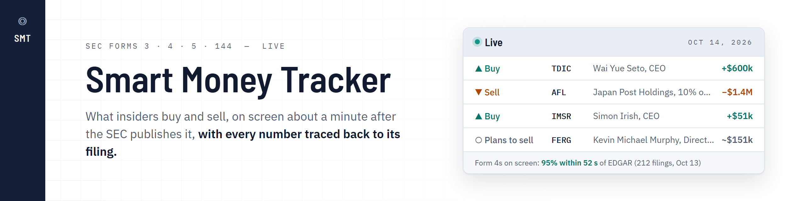
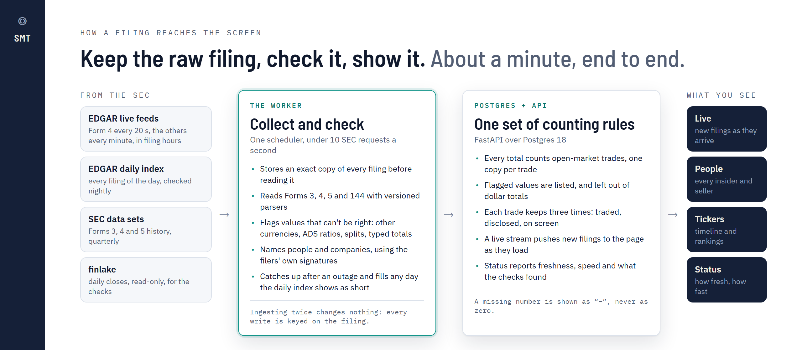
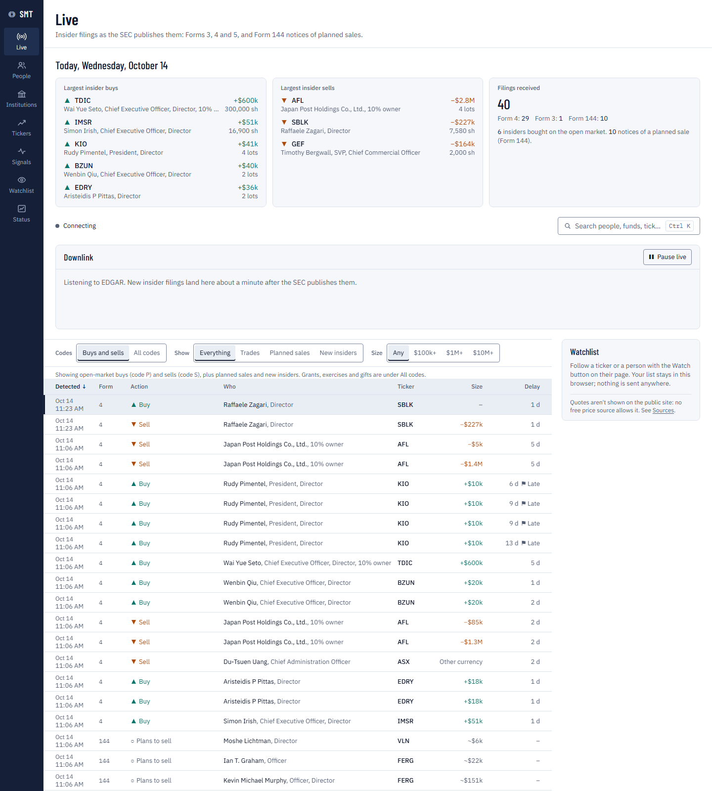
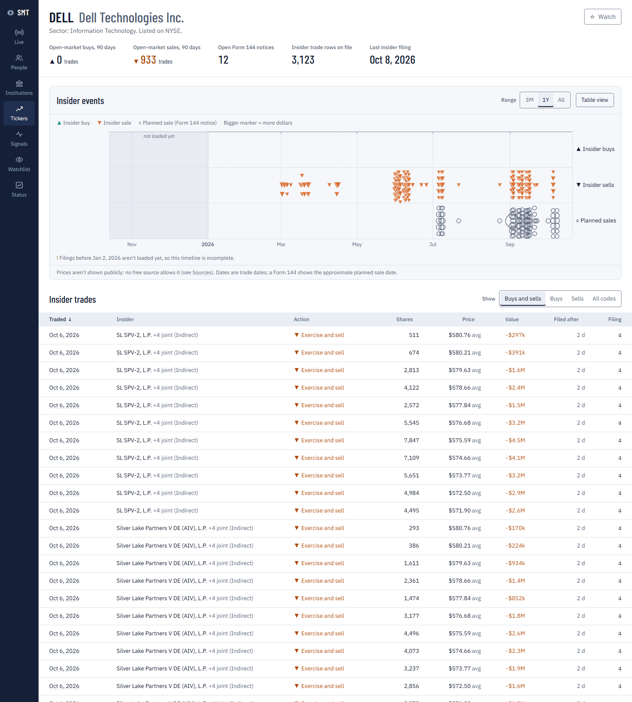
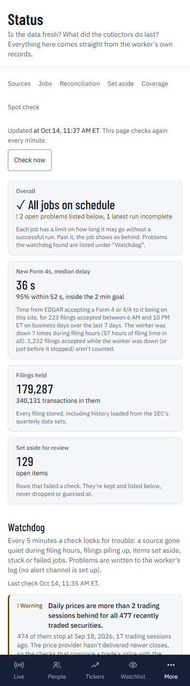
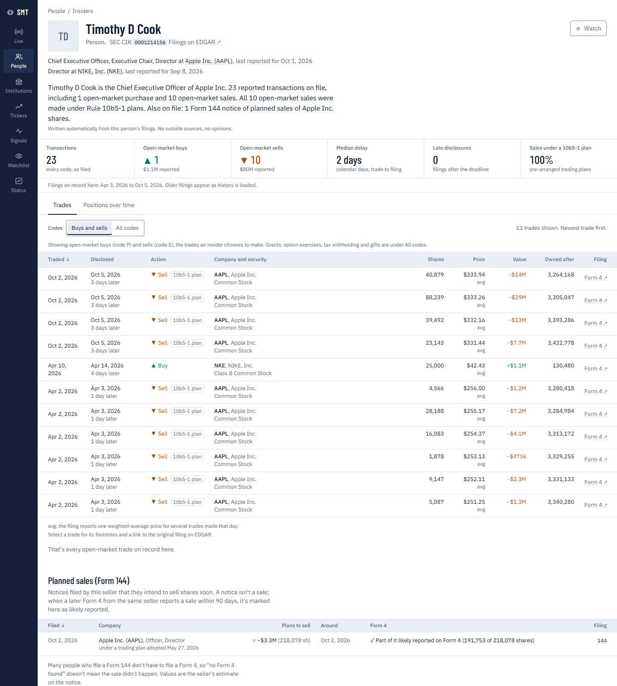
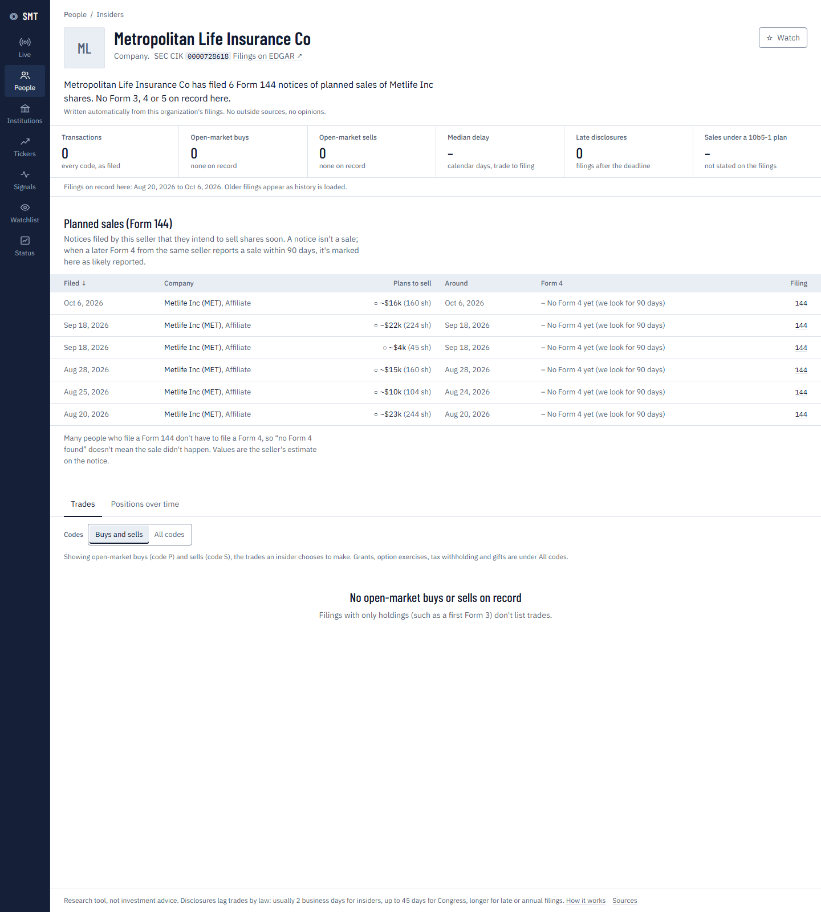
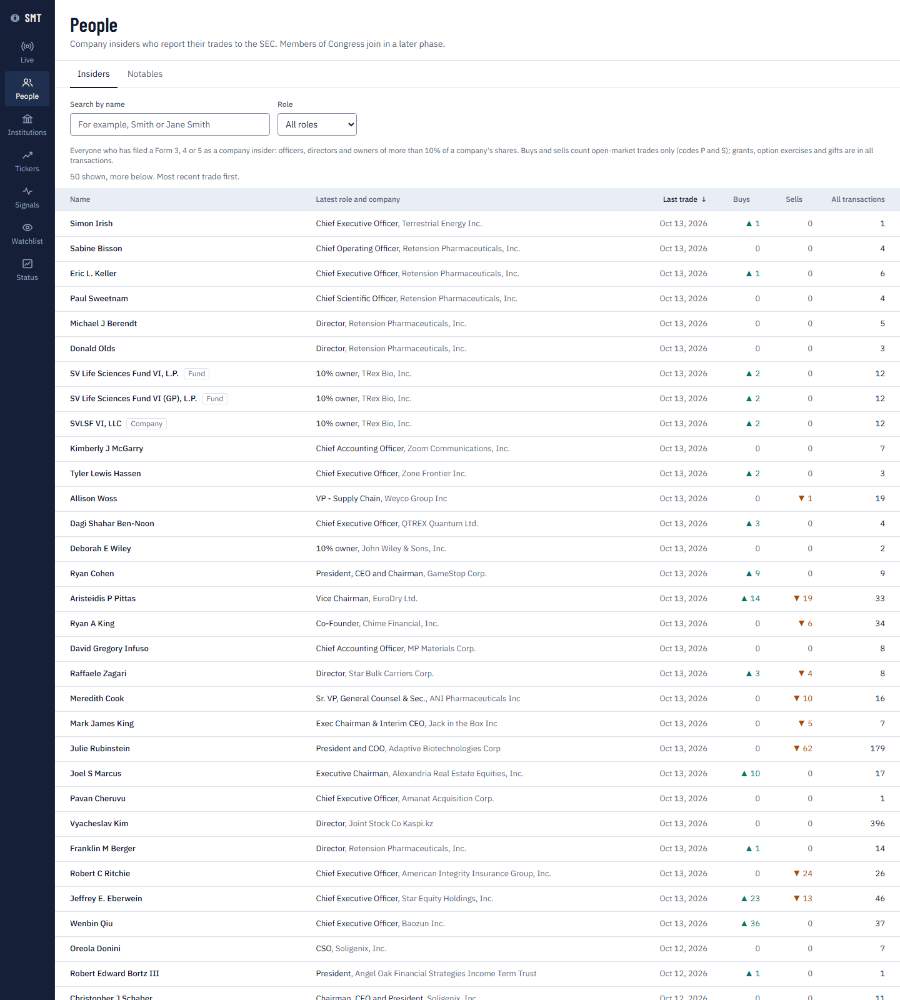
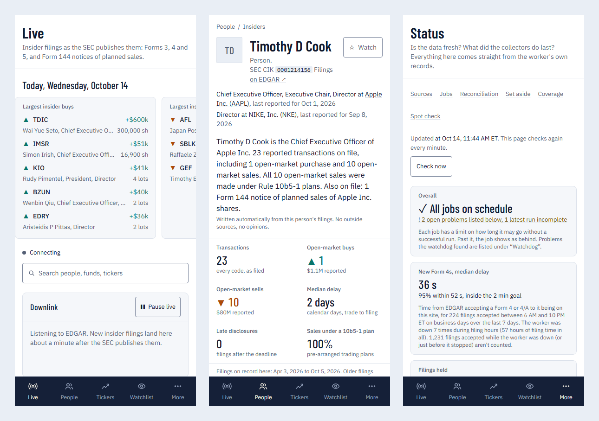

# Smart Money Tracker



Tracks what company insiders buy and sell, from official SEC filings only, and
aims to show each Form 4 within two minutes of EDGAR accepting it (`/status`
publishes the measured time). Members of Congress and institutions follow in
later phases.

Every number links back to the filing it came from.

> **Research tool, not investment advice.** Disclosures arrive on legal
> deadlines. Every trade shows when it happened, when it was disclosed, and
> when this site detected it.


---

## The one idea

**Prices can be live. Disclosures can't.** The law gives an insider two
business days to report a trade, so no site can show it sooner. What a site
can do is show it the moment the SEC publishes it, and be honest about the
rest. So every trade carries three times: when it was traded, when it was
disclosed, and when it reached this site, with the gaps between them.


Every number links to the filing it came from, and a number the filing
doesn't give stays blank, never zero.

---

## Status

**Phase 1 (insiders and Live) is built.** Phases 2 to 5 (Congress, 13F and
13D/13G institutions, signals, public launch) are planned in
[docs/plan/PLAN.md](docs/plan/PLAN.md). Progress and decisions are in
[docs/plan/PROGRESS.md](docs/plan/PROGRESS.md).

| Area | What's there |
|---|---|
| **Sources** | SEC Forms 3, 4, 5 and 144 (plus amendments). Live from the EDGAR feed; every day is checked against the SEC's daily index (a day counts as loaded at 99% of its filings). History comes from the SEC's quarterly Insider Transactions data sets. |
| **Live** | New filings as they arrive over a live stream. A "today" strip, a downlink band, a virtualized feed with filters in the URL, pause, and a watchlist panel. |
| **People** | Insider directory; a profile per person with roles, stats, trades and holdings over time. |
| **Tickers** | Companies ranked by open-market insider activity; per-ticker event timeline, insider trades and Form 144 notices. |
| **Trust** | `/status` (freshness, runs, watchdog, quarantine, coverage, spot-check), `/methodology` (every rule in plain English), `/sources` (terms and cadence of each source). |
| **Everywhere** | A quick-look drawer for any trade (`?trade=`), Ctrl+K search, keyboard navigation, phone layouts. |

The public site shows disclosures only. No free price source allows public
display, so prices appear only in a single-owner private mode (see
[Sources](docs/plan/source-verification.md) and PLAN.md decision 1). To turn
it on, set `PRIVATE_MODE_PASSPHRASE` and `SESSION_SECRET` (see the settings
table below), restart the API, and sign in at `/private`. Until then `/private`
only says that private mode isn't set up on this server.

## How it works



In more detail:

```
EDGAR Atom feed (Form 4 every 20 s, 3/5/144 every 60 s in filing hours) ─┐
EDGAR daily index (nightly, hourly retries, per-day coverage) ───────────┼─> queue ─> fetch (≤ 8 req/s, declared User-Agent)
SEC quarterly data sets (history backfill) ──────────────────────────────┘              │
                                                              v
                                   raw store (zstd, content-addressed): stored before parsing
                                                              │
                                                              v
                     versioned parsers ─> loaders (idempotent upserts on natural keys) ─> Postgres
                     (bad documents are quarantined, never dropped)                          │
                                                                                             v
            Next.js web  <── read-only FastAPI (+ SSE stream via LISTEN/NOTIFY) <────────────┘
```

- **One worker process** does all fetching, through a lease-based scheduler
  whose state lives in Postgres. It survives restarts, and it waits out
  database outages.
- **Loaders** encode the finance and legal rules:
  - late-filing flags from SEC business days and Reg S-T cutoffs;
  - joint-filer attribution;
  - 4/A amendment pairing;
  - exercise-and-sell grouping;
  - Form 144 ↔ Form 4 matching.

  Each one is explained in plain English on `/methodology`.
- **Data-quality flags.** Figures that can't be right as filed keep their
  numbers but are left out of totals and rankings: a trade dated after its
  filing, a total typed as the price (also when a filer does it on every row),
  a misplaced decimal, a price per ADS on a count of shares, a price in
  another currency or in a currency the filing doesn't state, an option priced
  above its share, a trade for 0 shares with a price. A value the filing
  doesn't give is shown as "–", never $0. The same trade filed by linked
  owners counts once, and amendments replace the rows they correct.
  `/methodology` lists every rule.
- **Watchdog.** Every 5 minutes it looks for stale sources, backlogs, stuck
  jobs and failed runs. It can alert through Apprise.

## Quick start (Windows, PowerShell)

The first-time setup is in [docs/plan/SETUP.md](docs/plan/SETUP.md). It
installs portable Postgres 18 and Node 24 under
`%USERPROFILE%\.smart-money-tracker`, and needs `uv` for Python 3.14. Then,
from the repo root:

```powershell
Copy-Item .env.example .env        # then set SEC_USER_AGENT (app name + your email)
.\scripts\dev.ps1                  # Postgres, migrations, API, worker and web, each in its own window
```

Open <http://localhost:3000>. The API docs are at <http://localhost:8000/api/docs>.

To load history (the latest two quarters by default; `-Since 2006q1` loads everything):

```powershell
.\scripts\backfill.ps1
```

To run everything CI runs (ruff, mypy strict, pytest, eslint, tsc, next build):

```powershell
.\scripts\test.ps1
```

With Docker Desktop, `.\scripts\dev.ps1 -Docker` runs the same stack in
Docker Compose. `infra/` has the production compose file and a Caddy config
for HTTPS on your own domain.

### Keeping it running

New filings are only caught live while the worker is running. On a laptop
that sleeps, nothing is lost (the nightly check against the SEC's daily index
and the gap filler load whatever was missed, and `/status` says which days
were loaded afterwards), but those filings aren't seen within two minutes.
For always-on collection, run the stack on a machine that stays awake, or on
a server with the files in `infra/`.

### Screenshots

`python scripts\screenshots.py` takes the pictures in
[docs/screenshots/phase1](docs/screenshots/phase1) from the running site, at
1440 px and at 390 px (phone), using Microsoft Edge's headless mode.

| Live | A ticker | Status (phone) |
|---|---|---|
|  |  |  |

| A person | A seller's Form 144 notices | People |
|---|---|---|
|  |  |  |

On a phone (Live, a person, Status):



The banner, the diagram and the explainer are drawn from HTML in
[docs/media/src](docs/media/src) (`python docs\media\src\render.py`); the tour and
the phone screens are taken from the running site (`python scripts\readme_media.py`).

## Configuration

Settings come from environment variables or `.env`
([.env.example](.env.example) documents each one).

| Variable | Needed | What it does |
|---|---|---|
| `SEC_USER_AGENT` | yes | App name + contact email. The SEC requires it on every request. |
| `DATABASE_URL` | yes | Postgres. The local default is port 5433. |
| `SEC_RATE_LIMIT` | no | Requests per second across all SEC hosts (default 8; the SEC's ceiling is 10). |
| `PRIVATE_MODE_PASSPHRASE`, `SESSION_SECRET` | no | Turn on the single-owner private mode (prices). |
| `PRICE_PROVIDERS` | no | `finlake` (read-only local data) and/or `yfinance` (private mode only). |
| `APPRISE_URLS` | no | Where watchdog alerts go (Discord, Telegram, email…). When empty, alerts only go to the log. |

## Repository layout

```
backend/   Python 3.14: FastAPI API, worker, parsers, loaders (package `smt`)
web/       Next.js 16 app (App Router, TypeScript, Tailwind v4)
config/    Calendars (market closures) and sector mapping
infra/     Docker Compose, Dockerfiles, Caddy
scripts/   PowerShell: db, dev, test, backfill; screenshots.py
docs/      Spec, plan, progress log, design sheet, source verification, screenshots
```

## Non-commercial

Congressional financial disclosure reports may not be used for any commercial
purpose other than news media dissemination, nor for credit ratings or
soliciting money (5 U.S.C. app. §105(c)). This project is non-commercial and
will stay that way: no ads, no paid tiers, no fundraising.

The code is MIT-licensed (see [LICENSE](LICENSE)). The data belongs to its
public sources.
