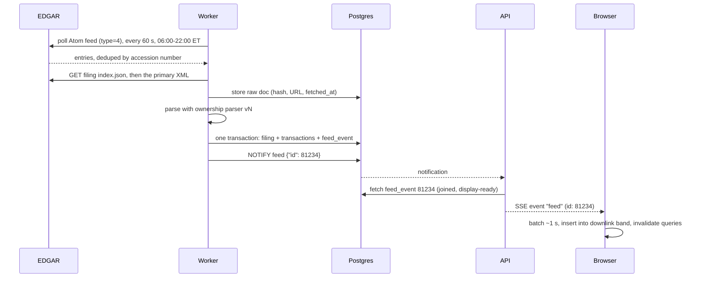
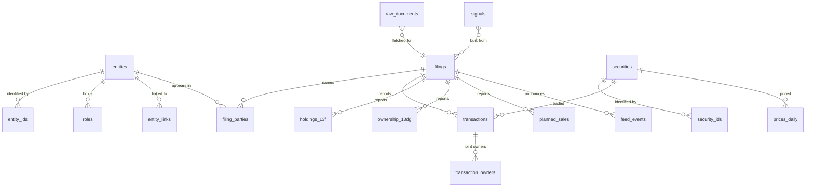

# Smart Money Tracker: build plan

Status: **draft for your approval** (spec §0 step 5). No feature code has been
written. Companion document: `docs/design/tokens-and-wireframes.md` (token
sheet and wireframes, spec §9). It also needs your approval before any UI code.

Contents

1. Decisions I need from you
2. What I found before planning (environment, finlake, lodestar, sources)
3. Architecture
4. Repository layout
5. Database schema
6. Ingestion design, per source
7. Live pipeline and freshness
8. Analytics and signals
9. API and front end
10. Accuracy and testing
11. Deployment and upkeep
12. Phase plan
13. Risks
14. Where I think the spec should change
15. Appendix: preliminary fund list (spec §7), fixture candidates, brand names

Supporting files: `source-verification.md` (all evidence), `SETUP.md`
(install steps for you), `PROGRESS.md` (resume checklist).

---

## 1. Decisions I need from you

Verification turned up three problems that change what's possible. Those come
first, and each item gives my recommendation.

- Items 1–7 each block something; the item says which phase.
- Item 8 lists defaults I'll use unless you object.
- Item 9 is optional.

**1. Prices can't be shown publicly on free data. (Blocks public launch; shapes Phase 1.)**
Every free price source I checked licenses its data for personal or internal
use only: Yahoo/yfinance, Finnhub, Massive (formerly Polygon), Tiingo, FMP and
Alpha Vantage. Finnhub's terms also cover "derived results", so computed
returns count too. Stooq now blocks scripts with a browser challenge. That
affects price charts, live quotes, and every return/performance figure in
§6 of the spec.

- **A.** Buy a display licence for end-of-day data. Before Phase 4, I'd bring
  you 2–3 priced options.
- **B.** The public site shows disclosures only. Filing prices, 13F values and
  PTR brackets are public-domain government data and are fine to show. Price
  charts, live quotes and return analytics appear only in **private mode**,
  which sits behind your admin login and is for your personal use. Private
  mode runs on finlake's store plus yfinance.
- **C.** Keep the whole site private until you choose a licence.

*Recommendation:* **B through Phase 3, then decide between A and B before
Phase 4.** The PriceProvider design tags every price with its licence
(`display_public`), so switching later is a config change, not a rewrite.

What changes under option B. Anything computed from licensed prices counts as
"derived results", so it follows the prices:

| Feature | Public under B | Private mode only under B |
|---|---|---|
| Every disclosure: trades, holdings, stakes, planned sales, with filing prices, 13F values and PTR brackets | yes | |
| Delays, late flags, coverage, filing-season tracker, QoQ 13F changes | yes | |
| Signals built from filings only: cluster buy, conviction buy, first purchase, selling cluster, late disclosure, committee overlap, activist stake, fund 10%-owner trade, consensus add/exit | yes | |
| Ticker page event timeline (all marker layers, no price line) | yes | |
| Price chart with markers, live quotes, watchlist prices | | yes |
| Buy-after-drawdown signal (needs a 52-week high) | | yes |
| Returns, follower returns, leaderboards by performance, 13F clone, hit rates, event studies | | yes |
| Smart Money Score | yes, computed only from public-safe signals | full version |

The Person and Fund wireframes show performance figures only in the
private-mode variant.

**Private mode** has one owner, you. It isn't a user-accounts system:
- You log in once with a passphrase stored in `.env`. The server sets a
  signed, HttpOnly, Secure, `SameSite=Strict` session cookie.
- Private responses carry `Cache-Control: private, no-store` and
  `Vary: Cookie`. Private pages render dynamically and never enter Next.js's
  shared cache, so licensed data can't leak to visitors through a cache.
- A test fetches every priced endpoint without the cookie and asserts that
  no price fields come back.

This is separate from the admin token used for backfill and reprocess. Since
the spec lists "user accounts" as a non-goal, this single-owner login is a
narrow exception, and I'm listing it in §14 for your approval.

**2. Congressional data must stay non-commercial. (Blocks Phase 2.)**
Both chambers print 5 U.S.C. app. §105(c): it's unlawful to use these reports
for any commercial purpose other than news media dissemination, for credit
ratings, or for soliciting money. Civil penalties go up to $10,000. The Senate
site also requires ticking an agreement box before searching. Please confirm
two things:

- the site stays non-commercial: no ads, no paid tier, no fundraising;
- you're OK with the Senate ingester accepting that agreement on each session
  on your behalf.

Nothing in this verification accepted it. In Phase 2, I'll capture the first
Senate fixtures only after you say yes.

**3. The Senate site may block a cloud server. (Affects Phase 2 and Phase 6.)**
Senate eFD sits behind Akamai. Several active 2026 scrapers report that Akamai
blocks datacenter and non-US IP addresses, sometimes with a 200-status "Access
Denied" page.

What I actually tested: from your home connection, the Senate front page
loads over plain HTTP with no bot challenge. The search and report pages sit
behind the agreement and weren't tested. Four active scrapers use plain HTTP
successfully.

The plan is to test the VPS as soon as it exists. If it's blocked, a small
**collector** mode runs on your PC (Docker Desktop):
- It fetches raw Senate pages and pushes them to the server's raw-store inbox.
- The push uses a dedicated collector token with HMAC-signed requests and a
  size limit, and accepts Senate files only.
- The server does all the parsing.
- A staleness alert fires if your PC hasn't delivered in 24 hours.

GitHub Actions isn't a real alternative: its runners use Azure datacenter IPs,
which are the kind Akamai blocks. OK?

**4. Before Phase 0 can start, you need to install or create:**

- Docker Desktop (with WSL2)
- Node.js 24 LTS
- an empty GitHub repo named `smart-money-tracker`. Tell me whether it should
  be public or private.
- optionally, the GitHub CLI (`gh`)

The PowerShell commands are in `docs/plan/SETUP.md`.

**5. Approve the fund list (Appendix 15.1).** All 44 names resolved to CIKs
from live SEC data, and 43 filed 13F-HRs for both of the last two quarters. The
exception is Vanguard, which reorganized in 2026 into 10 separate filing
entities. Within the 2013+ backfill window, six managers changed CIK
(Pershing Square, Greenlight, BlackRock, Jana, Elliott, Appaloosa), so a
fund's history needs a chain of CIKs, not one number. The schema supports
that.

Two more things to approve alongside the list:

- **A `consensus_eligible` flag.** It's off for quant and multi-manager firms
  (Renaissance, Citadel, Millennium, Two Sigma, D. E. Shaw, AQR, Point72) and
  for Gates Foundation Trust. Their high-turnover rebalancing would otherwise
  fire "consensus add" on most liquid stocks every quarter. They're still
  tracked and shown.
- **A minimum position weight of 0.5%** before a fund counts toward
  consensus.

**6. Approve the design** (`docs/design/tokens-and-wireframes.md`). Also choose
between keeping your original Night color or the indigo alternative in §2.4.
(Settled since: a black page on 2026-09-24, then on 2026-10-14 a white page with
light grey panels, dark text and a navy menu; the design sheet's §2 has the
current colors.)

**7. Free API keys that only you can register,** because registering accepts
their terms:

| Key | Needed for | When |
|---|---|---|
| OpenFIGI | CUSIP → ticker mapping about 100× faster: 25,000 vs 250 CUSIPs/min by OpenFIGI's documented limits (the keyed limit isn't verified yet). Without a key, the first mapping pass takes hours instead of minutes. Its Terms page also needs a read before Phase 3. | before Phase 3 |
| api.data.gov | Congress.gov and FEC (the demo key allows 10 calls) | Phase 5 |
| LDA (lda.gov) | lobbying data: 120/min instead of 15/min | Phase 5 |
| Finnhub | live quotes, **private mode only** (see item 1) | optional, Phase 1 |

**8. Defaults I'll use unless you object:**

- **Old Schedule 13D/13G filings** (before December 2024) are free-form
  HTML/text. For those I store only metadata: filer, company, date and form.
  That's enough to detect a 13G→13D switch, but amounts and percentages start
  with the structured filings from December 2024.
- **Form 3/4/5 history** goes back to 2006. The SEC's quarterly data sets make
  full history nearly free (11 MB per quarter), so there's no reason to stop
  at 2 years.
- **Paper PTRs** are listed as "not machine-readable — view original" and
  counted in the coverage report (spec §2.3). That's about 11% of House PTRs
  in 2026, including some frequent traders.
- **10b5-1 plan trades** are shown and labeled. They're excluded from the
  "discretionary selling" signal by definition.
- **Joint filings** (a fund, its GP and its manager) count as one trade,
  with all names shown. Attribution:
  1. If any listed owner is a fund or institution, or links to one, the
     trade goes to that institution.
  2. Otherwise it goes to the owner holding the shares directly.
  3. Otherwise it goes to the first listed owner.

  Two separate filings are merged as one trade only when their owners are
  explicitly linked in `entity_links` or the overrides file. Anything else
  that looks similar is flagged for review, never merged automatically.
- **Faster House detection (hypothesis to test).** The House index looked
  like it rebuilds once a day, at about 09:00 ET, but that's from one day of
  observation. Electronic PTR DocIDs looked sequential. If both hold, probing
  the next few DocIDs every 30 minutes (about 40 small requests an hour)
  would show new PTRs the same day.

  Phase 2 first measures the index timing and the probe hit rate for 5
  business days, and turns the fast path on only if it pays off. The daily
  index stays the source of truth either way.
- **Toolchain versions:**
  - Node 24 LTS, moving to Node 26 once it becomes LTS on 28 Oct.
  - TypeScript pinned to 6.x. TypeScript 7.0 ships without the compiler API
    that ESLint's TypeScript support needs.
  - ESLint 9.39. Several plugins don't support ESLint 10 yet.
  - TanStack Table v9 (new in August, so most online examples are for v8).

**9. Brand name (optional).** Three candidates with a collision check are in
§15.3. Top pick: **Lightlag**. It names the disclosure delay directly, and I
found no finance product using it. The .com is taken but idle. I'm keeping the
working title unless you choose one.

---

## 2. What I found before planning

### 2.1 Your machine

| Tool | Found | Needed for |
|---|---|---|
| Python | 3.14.7, plus `uv` | backend, tests, scripts |
| git | 2.55 | everything |
| Docker Desktop | **not installed** | `docker compose up` (Phase 0 onward) |
| Node.js | **not installed** | Next.js dev server, TypeScript tooling in VS Code, Playwright screenshots |
| GitHub CLI (`gh`) | not installed | optional; makes repo creation and CI checks easier |

The repo is at `Downloads\finlake_1\smart-money-tracker`, next to finlake and
lodestar, and it's a root folder in your main VS Code workspace. It's outside
OneDrive, so sync never touches `node_modules`, virtualenvs or database files.

Until Docker Desktop is installed, local development runs natively. PostgreSQL
18 (the official portable build) and Node 24 live in
`%LOCALAPPDATA%\smart-money-tracker`, with no admin rights and no system
changes. The Docker files are written too, and take over once Docker is
installed.

### 2.2 finlake: what it can and can't do for this project

I read its public API (`finlake/__init__.py`, `api.py`, `config.py`,
`http_client.py`, `sources/sec.py`, `sources/prices.py`). Reuse is thinner than
the spec assumes.

| Spec says reuse | What finlake actually has | Plan |
|---|---|---|
| SEC request conventions | `http_client.py`: **synchronous** `requests` with a thread-locked token bucket (8 req/s) and a gzip cache that only stores **JSON** | Reuse the conventions: the `SEC_USER_AGENT` env var, 8 req/s, backoff on 429/5xx, cached 404s. Rewrite the client as async `httpx`. The ingestion worker is asyncio, and a blocking client would stall it. Filings are also XML, HTML and PDF, which finlake's cache can't store. |
| ticker↔CIK normalization | `sources/sec.py` writes validity-dated `ticker_map` rows into finlake's **SQLite** file under `~/.finlake` | A production server won't have that file. The tracker keeps its own `security_ids` table in Postgres, built from `company_tickers.json` plus submissions JSON, and uses the same validity-window idea. |
| daily price bars | `finlake.prices(ticker)` reads a cached parquet file and **raises `FileNotFoundError` for any ticker it hasn't already fetched**. Fetching goes through a function that writes into finlake's own SQLite cache. | `FinlakePriceProvider` is **read-only and local-only**. It serves bars finlake already has (your ~500-name universe) and returns "not available" for everything else, so the next provider (yfinance) takes over. **This app never writes into `~/.finlake`.** |

Two lessons carried over from finlake's history:

- **Its `DATA_DIR` is bound at import time.** That's what let a test run delete
  15.5M real facts in August. The tracker's `conftest.py` sets `FINLAKE_HOME`
  to a temp directory before anything imports finlake, and hard-fails if the
  resolved path is still `~/.finlake`. Tests use a fake price provider and
  never import finlake at all.
- **Only an independent measure catches an error our own arithmetic agrees
  with.** Every source gets at least one external cross-check (§10).

Gaps become ISSUE notes in the vault instead of finlake edits: no async client,
JSON-only raw cache, no installable distribution (it isn't on PyPI and has no
remote), and the import-time data path.

### 2.3 lodestar

- `industry_map.csv` has **505 rows** (the S&P 500 plus Nasdaq-100 universe),
  with the columns `ticker,industry,sector`. Its settled decision (DEC-009) is a
  curated CSV with SIC as the fallback. I'll reuse it the same way. Tickers not
  in the CSV get a sector from their SEC SIC code via a small
  `config/sectors/sic_to_sector.yaml`. The label records which source it came
  from (`curated`, `sic`, or `unmapped`), and nothing is silently lumped into
  "Other".
- One caution for a public site: the CSV's industry names look like
  Yahoo/Morningstar labels. I'll display only the 11 broad sector names
  publicly and use the industry column internally (for the committee→industry
  map), unless you're comfortable showing it.
- lodestar's current look is navy with teal and red. See the design doc, §1.

### 2.4 Data sources, verified live

Verified live on 2026-09-23 by fetching the real endpoints and documents. A
second, independent agent tried to refute the claims that matter most. Every
row below cites what was observed, and the full evidence (URLs, headers,
element names) is in `docs/plan/source-verification.md`.

| Source | Status | What's true today, and what it changes |
|---|---|---|
| SEC fair access | confirmed | 10 req/s per IP across all machines. An undeclared or browser User-Agent gets **403 even at low rates**, and a breach triggers a 10-minute penalty. → One limiter, set to 8/s. Treat 403 as "throttled", never "not found". |
| EDGAR Atom `getcurrent` | confirmed, with caveats | Works, max 100 per page, `start=` paging. **`type=` is a prefix match:** `type=4` also returns 424B2 and 497 prospectuses. Use `owner=only` for Forms 3/4/5 and filter the exact form on our side. One accession appears once per filer role, and the copies can straddle pages. The `<updated>` timestamp is the acceptance time in ET with an offset. The feed window **shrinks over the day** (about 2 days deep in the morning, under 1 day by evening). The newest entry was 52 s old. |
| Filing dates | confirmed (Reg S-T 232.13) | Forms 3/4/5, 144 and 13D/13G accepted before **22:00 ET** get that day's date. Everything else (13F) cuts off at **17:30 ET**. → Store the acceptance time and the filing date separately. Never derive one from the other. |
| `index.json` | partially confirmed | No document-type field, and filenames vary (`ownership.xml`, `form4.xml`, `wk-form4_<ts>.xml`, 13F info tables named `56757.xml`). → Identify documents by root element, or by the SGML header's TYPE. Never guess filenames. |
| Daily index | confirmed | Published about 22:00–22:30 ET each business day. Includes SCHEDULE 13D/G and still some `SC TO-I` etc. → Nightly reconciliation at 23:00 ET, with a retry at 02:00 ET if the file isn't there yet. |
| Schedule 13D/13G names | **changed** | Since 18 Dec 2024: `SCHEDULE 13D`, `SCHEDULE 13D/A`, `SCHEDULE 13G`, `SCHEDULE 13G/A`. **`type=SC 13D` now silently returns nothing.** Other `SC …` forms still exist, so a blanket rename would be wrong. 13D and 13G XML use *different element names* for the same things (e.g. `percentOfClass` vs `classPercent`), so they need two parsers. |
| Insider Transactions data sets | confirmed | Quarterly, 2006 Q1 to 2026 Q2, about 11 MB zipped each. `AFF10B5ONE` was added in 2025 but the readme PDF is stale, so read columns from the zip's metadata JSON. **The newest file moved to a new URL path.** → Discover links by scraping the page. |
| 13F data sets | **changed** | Since 2024: 3-month *filing-date* windows (`01jun2026-31aug2026_form13f.zip`, 100 MB), not calendar quarters. Late filers show up in later windows. Also moved path. |
| Form 4 XML | confirmed, details changed | Schema `X0609` (Forms 4/5), `X0607` (Form 3), `X0508` still common in 2025. The 10b5-1 box is `<aff10b5One>`. Booleans come as `true/false` **or** `1/0`. Values can be footnote-only. There's a new foreign-ticker field. Up to 10 owners and 30 rows per table. Real filings contain errors (a sale coded "acquired"). |
| Form 4/A | partially confirmed | **No link to the original accession,** only `dateOfOriginalSubmission`. Amendments re-report only the changed lines. → Match heuristically, merge line by line, and record the match confidence. |
| Form 144 | partially confirmed (the XML start date wasn't observed) | XML, a different namespace from Form 4, `MM/DD/YYYY` dates. The filer credential is the seller. 144/A carries `previousAccessionNumber`. It includes the 10b5-1 plan adoption date. A real 144 → Form 4 match was found (Snowflake, 50,000 shares, same day). |
| 13F XML | confirmed, one rename | Tech spec v2.0 (**14 Sep 2026**) renamed `provideInfoForInstruction5` to `provideInfoForInstruction`, with the schema version unchanged. `isAmendment` is sometimes absent. The same CUSIP can appear in several rows. The optional FIGI column is used by some filers. |
| 13F units | confirmed, plus a surprise | Thousands before 3 Jan 2023, whole dollars after, **decided by filing date**. The schema version can't tell them apart. **Duquesne and Baupost still file in thousands in 2026.** → The implied-price check (§10) is a required correction step, not an optional audit. |
| 13F amendments | confirmed | RESTATEMENT replaces, NEW HOLDINGS adds (up to amendment No. 6 seen for one period). `confDeniedExpired=true` marks previously confidential positions being revealed. |
| Rule 13f-2 / Form SHO | not in effect | Exempted until 2 Jan 2028. No short-position data exists to ingest. |
| House Clerk index ZIP | partially confirmed (one day observed) | 2008–2026 available. Every year's ZIP is rebuilt **once a day at about 09:00 ET**, so the index lags by T+1. **`If-None-Match` is ignored; only `If-Modified-Since` returns 304.** The PTR folder uses the index's Year field, not the filing date. |
| House PTR PDFs | confirmed | Electronic PTRs have 8-digit DocIDs starting with `2`, producer `EO.Pdf`, and extractable text. Paper PTRs have 7-digit IDs and are image-only: **46 of 400 in 2026** (11%). Label text is glyph-obfuscated (only first letters extract), so parsing must be position-based. Amendments and deletions are **per row**, inside a new DocID. Old PDFs (2013–2020) are still online. |
| House amounts | partially confirmed (`$25,000,001+` brackets not seen in 2026) | 8 brackets up to `$5,000,001 - $25,000,000` seen, plus `Spouse/DC Over $1,000,000` and **exact dollar values** (e.g. `$15.00`). |
| Senate eFD | confirmed from code, not live | A plain Django CSRF form, no JavaScript needed. The agreement text is quoted in decision 2. The data endpoint is a POST returning JSON rows. Electronic PTR pages are HTML tables. Paper PTRs are images. Amendments are new reports titled "(Amendment N)" with **no link to the original**. **Akamai blocks many datacenter IPs** (decision 3). Only about 6 years of reports are kept online. |
| House/Senate Stock Watcher | dead | S3 403, domains don't resolve. |
| congress-legislators | confirmed | Current to 3 Sep 2026 (539 members). `bio.religion` no longer exists. Committee membership has known errors (open issues #1065, #1066). |
| unitedstates/images | **stale** | CC0, but no updates since May 2026 and its scraper is broken. **15 current members have no portrait.** → Fallback: the Congress.gov member image (with attribution), then an initials avatar. |
| Congress.gov API | confirmed | 5,000/hour with a real key. DEMO_KEY allows about 10 calls. |
| H.R. 7008 | confirmed as stated | Passed the House 22 Jul 2026 (232–198, Roll 280). On the Senate calendar (No. 548) since 6 Aug, with no action since. It would require notice 7–14 days before each sale, published by the Clerk/Secretary. It also carries an unrelated voter-ID section, which makes Senate passage harder. → `planned_sales` supports it, behind a flag. |
| OpenFIGI | partially confirmed | No-key limit confirmed live: 25 requests/min × 10 jobs. The keyed limit (25 per 6 s × 100 jobs) comes from the docs only. The Terms page hasn't been reviewed. **A CUSIP returns hundreds of exchange-level FIGIs** (277 for Apple) → request `exchCode=US` and key on the composite FIGI. |
| Prices | **licensing blocker** | See decision 1. yfinance 1.7.0 works on Python 3.14 but occasionally misses sessions (e.g. 2026-08-28). **Five sector ETFs split 2:1 on 2025-12-05** (XLB, XLE, XLK, XLU, XLY), so unadjusted series show fake −50% drops. finlake's store has 707 tickers back to 1962, but 162 of them haven't updated since 2026-08-13. |
| Lightweight Charts | confirmed | v5.2, Apache-2.0. Keep the attribution logo on (or a visible link) and ship the NOTICE file. Markers use `createSeriesMarkers` (the v4 `setMarkers` is gone). |
| USAspending | confirmed | No key. **It silently ignores invalid filters** (200 status plus a note in `messages`). One company has several parent UEIs, and the one on a child record can be an empty shell. The most recent ~3 months of DoD contracts are near zero because of DoD's reporting delay. |
| LDA | **moved** | `lda.senate.gov` now redirects permanently to `lda.gov/api/v1/`. 15/min anonymous, 120/min with a key. Bill numbers exist only in free text. |
| FEC, OGE 278-T, FINRA, N-PORT, Form ADV | partly checked | Enough for Phase 5 planning. Each gets a verification step at the start of the phase that uses it (details in the evidence file). |
| Python 3.14 stack | confirmed | **Nothing forces 3.13.** All ~45 backend packages have cp314 wheels for x86-64 and ARM, or are pure Python. Images: `python:3.14-slim` (Debian trixie), `postgres:18` (pg_trgm included), `caddy:2.11`. |
| Front-end stack | confirmed, three traps | Next.js 16.3 (Cache Components, `proxy.ts`, Turbopack). **TypeScript 7 ships without the compiler API** that ESLint's TypeScript support needs → pin 6.x. **ESLint 10** breaks several plugins → 9.39. **TanStack Table jumped to v9** in August. |
| Caddy SSE | confirmed from docs and source, not yet run | Streams `text/event-stream` unbuffered by itself. **Keep the SSE route out of `encode`**, which would gzip it. The backend has to notice disconnects itself. |
| Postgres NOTIFY | confirmed | Payload under 8,000 bytes → send ids only. psycopg needs a dedicated autocommit connection. |

---

## 3. Architecture

```mermaid
flowchart LR
  subgraph ext[Public sources]
    EDGAR["SEC EDGAR<br/>Atom feed, index.json,<br/>daily index, bulk data sets"]
    HOUSE["House Clerk<br/>yearly index ZIP + PTR PDFs"]
    SENATE["Senate eFD<br/>search + PTR pages"]
    LEG["congress-legislators<br/>+ official portraits"]
    FIGI["OpenFIGI<br/>CUSIP to ticker"]
    PX["Daily prices<br/>finlake (local only), yfinance,<br/>optional paid"]
    QT["Live quotes<br/>(provider per licence)"]
  end

  subgraph worker["worker container: one asyncio process"]
    SCHED["Scheduler<br/>job leases in Postgres"]
    FETCH["Fetchers<br/>one rate limiter per host,<br/>live jobs before backfill"]
    RAWS[("Raw store<br/>compressed, content-addressed")]
    PARSE["Versioned parsers"]
    LOAD["Loaders<br/>idempotent upserts,<br/>quarantine on failure"]
    DERIVE["Derivations<br/>13F changes, positions,<br/>returns, signals, score"]
    WATCH["Watchdog + reconciliation"]
  end

  DB[("PostgreSQL 18<br/>+ pg_trgm")]
  API["api container<br/>FastAPI, read-only<br/>SSE /api/stream"]
  WEB["web container<br/>Next.js standalone"]
  CADDY["Caddy<br/>HTTPS, routing, no SSE buffering"]
  ALERT["Apprise<br/>Discord / Telegram / email"]
  USER(("Browser"))

  EDGAR & HOUSE & SENATE & LEG & FIGI & PX --> FETCH
  SCHED --> FETCH --> RAWS --> PARSE --> LOAD --> DB
  LOAD -- "NOTIFY feed (row ids only)" --> DB
  DERIVE <--> DB
  WATCH --> DB
  WATCH --> ALERT
  DB -- "LISTEN" --> API
  QT --> API
  USER --> CADDY
  CADDY -- "/api/*" --> API
  CADDY -- "everything else" --> WEB
  WEB -- "server-side fetch" --> API
```



**Following one Form 4 from EDGAR to your screen:**



Why it's shaped this way:

- **One process owns all outbound traffic.** Backfills don't run as separate
  scripts that each hit the SEC. `scripts\backfill.ps1` queues a backfill job,
  the worker runs it, and the script follows its progress. One process means
  one rate limiter per host, so the SEC budget can't be exceeded by two
  processes each thinking they have 8 req/s. Live polling always outranks
  backfill for the next token.
- **Heavy work never blocks the poller.** The worker's asyncio loop does only
  network I/O and scheduling. CPU-heavy steps run in a process pool:
  - PDF text extraction
  - parsing 50k-row 13F tables
  - DuckDB bulk jobs

  All HTTP still goes through the one async process, so the rate limiter
  stays single. /status shows event-loop lag, which exposes a blocked loop
  right away.
- **The database is the queue, the event bus, and the scheduler's memory.**
  There's no Redis. Postgres `LISTEN/NOTIFY` carries row ids only, which stays
  well under the 8,000-byte payload limit. Scheduler leases and backfill
  cursors live in tables, so a crash or restart resumes where it left off.
- **The API never computes, it only reads.** This follows lodestar's rule that
  the UI reads completed runs. Heavy aggregates are materialized by the worker.
- **The browser talks to FastAPI directly for `/api/*`**, including the SSE
  stream. Caddy routes by path and doesn't buffer SSE. Next.js is only a page
  renderer, so a stuck render can never block the live stream.

---

## 4. Repository layout

```
smart-money-tracker/
  backend/
    pyproject.toml, uv.lock          pinned versions, uv-managed
    src/smt/
      config.py                      settings from .env (pydantic-settings)
      db/                            SQLAlchemy models, session, Alembic migrations
      net/                           async HTTP client, per-host limiter, raw store
      domain/                        pure logic: business days, brackets, codes, amendments
      sources/
        edgar/                       feed poller, index.json, daily-index reconcile, bulk data sets
        forms/                       parsers: ownership (3/4/5), form144, thirteen_f, schedule_13dg
        congress/                    house index + PDF parser, senate eFD, legislators, name matching
        prices/                      PriceProvider interface + finlake, yfinance, (paid) providers; quotes
        figi.py                      OpenFIGI client with permanent cache
      analytics/                     holdings changes, returns, performance, signals, score, event studies
      worker/                        scheduler, job registry, watchdog, entry point
      api/                           FastAPI app, routers, response schemas, SSE, rate limiting
      cli.py                         smt backfill / reprocess / reconcile / status
    tests/
      conftest.py                    environment guards (test DB only, never ~/.finlake)
      fixtures/golden/               real filings saved verbatim + exact expected output
      unit/  integration/
  web/                               Next.js App Router, strict TS, Tailwind
    src/app/                         routes: live, people, institutions, tickers, signals, watchlist, status
    src/components/                  tables, charts, drawer, command palette
    src/lib/api/                     types GENERATED from FastAPI's OpenAPI schema (never hand-written)
  config/
    funds.yaml  notables.yaml  signals.yaml  committee_industries.yaml
    sectors/sic_to_sector.yaml
    overrides/member_matches.yaml  fund_owner_links.yaml  security_matches.yaml
  infra/
    docker-compose.yml               dev (bind mounts, hot reload)
    docker-compose.prod.yml          prod (GHCR images, restart policies, log rotation)
    Caddyfile  backend.Dockerfile  web.Dockerfile  backup/
  scripts/                           dev.ps1  backfill.ps1  reprocess.ps1  test.ps1
  docs/                              plan/ design/ architecture.md methodology.md data-sources.md deploy.md
  .github/workflows/                 ci.yml  deploy.yml
  CLAUDE.md  README.md  LICENSE (MIT)  .env.example  .gitattributes  .editorconfig
```

TypeScript is limited to the front end. The API contract comes from Python:
FastAPI publishes OpenAPI, and `openapi-typescript` generates the front end's
types. When a Python response model changes, the TypeScript build fails
wherever the UI uses the old shape. You never have to write those types
yourself.

---

## 5. Database schema

All times are stored as `timestamptz` in UTC and shown in ET for filing
events, because EDGAR runs on ET. Trade dates are plain `date` columns
because disclosures don't include trade times.



### 5.1 Identity

| Table | Key columns | Notes |
|---|---|---|
| `entities` | id, kind, name, sort_name, slug (unique), tags[], summary, summary_source, photo_url, photo_credit | kind: `person`, `politician`, `fund`, `bank`, `index_manager`, `company`. Tags cover overlaps such as "activist", "tracked", or a senator who is also a company director. |
| `entity_ids` | entity_id, scheme, value, valid_from, valid_to, source | schemes: `sec_cik`, `bioguide`, `fec`, `wikidata`, `opensecrets`, `lda`, `crd`. Unique on (scheme, value). |
| `entity_links` | from_id, to_id, link_type, source, confidence, note | `manager_of`, `general_partner_of`, `affiliate_of`, `reporting_alias_of` (a fund's Form 4 owner CIK → its 13F filer). Manual links go in `config/overrides/fund_owner_links.yaml`. |
| `roles` | entity_id, org_entity_id, role_type, title, start_date, end_date, source_filing_id | Officer, director and 10% owner come from Forms 3/4. Senator and representative come from congress-legislators. Committee seats are stored here too. |
| `committees`, `committee_members` | thomas_id, chamber, parent; member, title, rank, congress, **valid_from, valid_to** | from congress-legislators. Seats are dated, and history is rebuilt from the dataset's git history (§6.9). The committee-overlap flag is only computed where a member's seats are known for the trade date. |
| `committee_industries` | committee_id, sector, industry, rationale | loaded from `config/committee_industries.yaml`; shown on Methodology |

### 5.2 Securities

| Table | Key columns | Notes |
|---|---|---|
| `securities` | id, issuer_entity_id, name, class_title, security_type, primary_ticker, exchange, sector, industry, sector_source, sic, is_active, delisted_on | One row per tradable class: BRK.A and BRK.B are separate, with the same issuer. |
| `security_ids` | security_id, scheme, value, valid_from, valid_to, source, confidence | `ticker`, `cusip`, `figi`, `composite_figi`. **Tickers carry validity windows** because symbols get reused. A 2014 PTR's "FB" must resolve as of 2014. |
| `figi_cache` | cusip (PK), status, figi, ticker, name, exch_code, security_type, mapped_at, raw | Permanent OpenFIGI cache. `unmapped` is a cached answer too. |

### 5.3 Raw documents and filings

| Table | Key columns | Notes |
|---|---|---|
| `raw_documents` | id, source, url, sha256, fetched_at, http_status, etag, last_modified, content_type, bytes, storage_path, parse_status, parser_name, parser_version, parse_error | Unique on (url, sha256). Parse status is one of `pending`, `parsed`, `failed`, `quarantined`, `not_machine_readable`, `skipped`. The blob sits on disk, zstd-compressed and named by hash. |
| `filings` | id, source, form_type, source_key (accession or DocID or eFD id), accepted_at, filed_on, period_of_report, url, primary_doc_url, is_amendment, amends_filing_id, amendment_type, superseded_by_id, machine_readable, detected_at | Unique on (source, source_key). `detected_at` is when **we** first saw it. |
| `filing_parties` | filing_id, entity_id, role, is_primary | `reporting_owner`, `issuer`, `filer`, `subject_company`, `other_manager` |

### 5.4 Trades (Form 4/5 and congressional PTRs, later OGE 278-T)

`transactions`: one row per reported line.

| Group | Columns |
|---|---|
| identity | id, filing_id, source, line_no, **dedupe_key (unique)** = source + filing key + table + line |
| who | entity_id (the attributed owner, counted once), owner_type (`self`, `spouse`, `joint`, `dependent`, `indirect`), ownership_nature (D/I), nature_text |
| what | security_id (nullable), raw_asset_text, raw_ticker, asset_type_code (ST, OP, …), match_method, match_confidence, is_derivative, underlying_security_id |
| how | direction (`buy`, `sell`, `exchange`, `other`), code (P, S, A, M, F, G, …), is_open_market, is_10b5_1 (nullable: blank before 2023), exercise_and_sell_group |
| how much | shares, price, price_is_weighted_avg, value **or** value_low + value_high + value_is_bracket (false means an exact figure) + value_high_open (true for "Over $X" brackets), shares_owned_after |
| when | traded_on, deemed_execution_on, notified_on (PTR), disclosed_at, **disclosed_precision** (`timestamp` or `date_only`), detected_at, delay_days, deadline_on, deadline_rule, is_late, late_limb, business_days_late, filer_timeliness (the filing's own E/L field) |
| lineage | supersedes_id, superseded_by_id, is_current, footnotes (jsonb, verbatim), comment, parser_version |

**Keys are the same whichever path a filing arrives by.** The same accession
can come from a bulk SEC data set (backfill) or from the live XML poller, so
both paths must produce identical keys. Otherwise one trade loads twice and an
ingest-twice test on a single path would never notice.

- `line_no` is always the row's 1-based position in the primary XML, per
  table.
- Bulk loads derive it from the data set's per-accession order and verify it
  against the XML on a sample.
- Where the two disagree, the loader falls back to a content key (security
  title, date, code, shares, price, acquired/disposed).
- A golden test loads one accession from the data set, then from the XML,
  and asserts a single set of rows.

`transaction_owners(transaction_id, entity_id, is_primary)` records every name
on a joint filing. Aggregates count `transactions`, never
`transaction_owners`, so a fund, its GP and its manager reporting the same
trade count as one trade.

`insider_positions` is materialized: owner, issuer, security title, ownership
nature, as-of date, shares after. It's rebuilt from
`sharesOwnedFollowingTransaction` and powers the "positions over time" chart.

### 5.5 Institutions

| Table | Notes |
|---|---|
| `filing_13f_meta` | period, report_type, amendment_type, amendment_no, confidential_omitted, table_entry_total, table_value_total, **value_multiplier** (1000 or 1, from the units rule), other_managers (jsonb) |
| `holdings_13f` | filing_id, filer_id, period, row_no, cusip, security_id, issuer_name, title_of_class, **value_usd** (normalized), shares_or_principal, sh_prn, put_call, discretion, other_manager, voting_sole, voting_shared, voting_none. Partitioned by year. |
| `holdings_13f_effective` | Per filer-quarter after amendments: a RESTATEMENT replaces, NEW HOLDINGS adds. Every downstream calculation reads this and never reads raw rows. |
| `holdings_13f_changes` | filer, period, security, put_call, shares/value/weight prev and curr, split-adjusted share delta, action (`new`, `add`, `trim`, `exit`, `unchanged`, `previously_confidential`), split_suspected, quarters held |
| `filer_quarter_stats` | total value, positions, top-10 weight, HHI, turnover, sector mix, avg quarters held, size tilt (median position value), style label (thresholds in config), complete (false if confidential or NT) |
| `security_quarter_aggregates` | Per security per quarter across **all** filers: holders, new holders, exits, net shares, total value. Tracked hedge funds are counted separately, and banks and index giants are excluded from "smart money" counts. |
| `ownership_13dg` | filing_id, filer, subject issuer, security, cusip, schedule (13D/13G), amendment_no, event_date, shares, percent_of_class, sole/shared voting and dispositive, reporter type, purpose_text (13D Item 4), is_structured, prev_filing_id, switched_from_13g, stake_change_pp |
| `planned_sales` | Form 144 (later H.R. 7008 notices): seller, issuer, security, shares, market value, approximate sale date, broker, status (`open`, `matched`, `no_form4_found`), matched Form 4 transaction ids |

Storage scope for 13F: **tracked filers get full history. All filers get the
latest four quarters, on a rolling window. Aggregates cover all filers for
full history.** That gives every ticker page a real "top holders" list without
keeping 13 years of every filer's rows. See §14 for why this differs from the
spec.

### 5.6 Prices, analytics, operations

| Table | Notes |
|---|---|
| `prices_daily` | (security_id, date) PK, OHLCV, adj_close, source, fetched_at. Delisted securities stay, with `price_status = unavailable` if no source has them. |
| `trade_returns` | transaction_id, basis (`trade_date` or `disclosure`), horizon (30/90/180/365), entry/exit date and price, return, SPY return, excess, sector ETF, sector excess |
| `entity_performance` | entity, basis, horizon, weighting (`equal` or `midpoint`), n, mean, median, hit rate, 95% CI, price coverage |
| `signals` | type, security_id, entity_ids[], fired_at, detected_at, score, inputs (jsonb), explanation, source_filing_ids[], config_version, status |
| `signal_event_studies` | signal type, horizon, n, mean excess, CI low/high, method, as_of |
| `smart_money_scores` | security_id, as_of, score, breakdown (jsonb) |
| `feed_events` | One row per Live item (any source), written in the same database transaction as its source rows. Keyset-indexed on (detected_at, id). It's the SSE replay log. `is_live` is false for rows written by backfill, reprocess or reconciliation, so a reprocess never floods the Live feed. |
| `ingestion_runs` | source, job, started/finished, status, docs fetched, new/updated rows, parse failures, max lag, error |
| `scheduler_jobs` | job, next_run_at, lease_until, leased_by, cursor (jsonb) for resumable backfills |
| `quarantine` | source, raw_document_id, row reference, reason, payload, created_at, resolved_at, resolution. Shown on /status. |
| `reconciliation_results` | date, source, expected, found, missing (jsonb), explained (jsonb) |

Idempotency: every loader upserts on the natural key (`dedupe_key`,
`(source, source_key)`, or `(filing_id, row_no)`). Loading the same raw
document twice leaves every row count unchanged, and there's a test for it.

---

## 6. Ingestion design, per source

Every source follows the same five steps:

1. Fetch through the shared client.
2. Store the raw document.
3. Parse it with a versioned parser.
4. Validate (failures go to quarantine).
5. Upsert on the natural key, write `feed_events`, and NOTIFY, all in one
   transaction.

### 6.1 SEC EDGAR: shared client

- **Rate limiting:** one async `httpx` client with a token bucket per host.
  The SEC hosts share one budget of **8 req/s** total, with priority lanes:
  live beats reconciliation, which beats backfill.
- **Required headers:** `User-Agent` from `SEC_USER_AGENT` and gzip on every
  request.
- **Error handling:**
  - A 403 is treated as throttling. The client backs off for 11 minutes
    (longer than the SEC's 10-minute penalty) and raises an alert.
  - A 429 or 5xx gets exponential backoff with jitter. The Akamai 503
    maintenance page is recognized and retried.
  - A 404 is cached.
- **Raw store:** zstd-compressed, content-addressed by SHA-256, with URL,
  status, headers and fetch time recorded in `raw_documents`.

### 6.2 EDGAR live poller

- **Six feeds, polled every 60 s from 06:00 to 22:00 ET on business days and
  every 10 minutes otherwise:**
  - `type=4&owner=only`, which also covers 4/A
  - `type=3&owner=only`
  - `type=5&owner=only`
  - `type=144`
  - `type=13F-HR` plus `type=13F-NT`
  - `type=SCHEDULE 13D` plus `type=SCHEDULE 13G`
- **Parsing each entry:** the accession comes from `<id>`, the exact form from
  `category@term`, CIK and role from the title, and acceptance time from
  `<updated>`. Anything whose form isn't on our exact allow-list is dropped.
- **Deduplication:** entries are grouped by accession across pages. The roles
  become `filing_parties`.
- **Paging:** keep paging until a page overlaps an already-seen accession.
  Because the feed window shrinks during the day, if the gap since the last
  successful poll is longer than the feed covers, the worker queues a
  daily-index sweep for the missing dates instead of paging deep.
- **Fetching a new accession:** get `index.json`, then the candidate XML
  documents. Classify each by root element (`ownershipDocument`,
  `edgarSubmission` with the 144, 13F or 13D/G namespace, or
  `informationTable`). If that's ambiguous, fall back to the SGML header's
  `<TYPE>`.
- **Reconciliation:** at 23:00 ET, `form.YYYYMMDD.idx` is compared with
  `filings` for our form types. Anything missing is fetched and recorded as a
  poller miss on /status.

### 6.3 Forms 3/4/5

- **Parser:** one namespace-free parser. It accepts any `X0\d{3}` schema,
  records the version, and logs versions it hasn't seen before.
- **Coercion:** booleans accept `true/false/1/0/""`. Every `<value>` is
  optional, and a field can hold footnote references instead.
- **Codes:** the 18 XML codes, plus K and V derived from `equitySwapInvolved`
  and `transactionTimeliness`. Only P and S are "signal" codes by default.
- **Form 3** is a holdings snapshot, not trades. It marks when someone became
  an insider (used for tenure).
- **Form 5** rows keep their `transactionFormType` and timeliness, and
  **aren't treated as fresh activity**. A Form 5 row can be 11 months old.
- **Joint filings:** one set of transactions per accession, with every owner
  in `transaction_owners`. Related entities also file *separate* Form 4s for
  the same trade (see the Dell remarks). A cross-accession check (same issuer,
  date, code, shares and price, with overlapping owner families) merges them
  and records the reason.
- **Exercise and sell:** same-day M plus S by the same owner gets an
  `exercise_and_sell_group` and is labeled "exercise and sell".
- **4/A matching happens at the filing level first.** The original is the
  filing with the same issuer, an overlapping owner CIK, and a filing date
  equal to `dateOfOriginalSubmission`. Rows are then paired by table
  position, or by a loose key that leaves out the likely corrected fields
  (shares, date and code are exactly what amendments fix).
  - An original row with no partner is marked **"superseded, not re-reported:
    needs review"** and stops counting. It's never left silently current.
  - Several candidate originals means quarantine.
  - Each match stores its method and confidence.
  - An amendment with no data change (a POA-only 4/A, for example)
    supersedes nothing.
- **Deadlines:**
  - The late flag applies only to transactions that the Form 4 two-business-
    day rule covers. It's never set when the filer marked the row as early
    (timeliness E / code V).
  - The filer's own "late" mark (timeliness L) is a cross-check. Any
    disagreement with our calculation goes to /status.
  - The deemed execution date replaces the trade date when present. Rule
    16a-3(g) caps how late a deemed date can be, and that cap wasn't
    observed during verification. So Phase 1 reads the rule text first, and
    until then late flags are labeled "approximate".
  - The 10b5-1 plan adoption date is pulled out of footnote text when a
    footnote states it.
- **Validation** quarantines rows that can't be right: P with code D, a
  negative number of shares, or a price outside that day's range by more than
  10%. That last check runs only where we have a licensed price, and
  otherwise gets a flag instead.

### 6.4 Form 144

- A separate, namespace-aware parser.
- It's keyed to the seller CIK plus the issuer CIK. A 144/A supersedes the
  filing named in its `previousAccessionNumber`.
- **Matching to later Form 4s:** same seller and issuer; S-code (sale) rows
  only; dated from one day before the 144's filing date to 90 days after.
  The **running total** of matched shares is compared with the planned
  amount, because one planned sale is often executed in several Form 4 rows.
  The match is shown as "likely executed by", with a confidence score.
- After 90 days with no match, the status reads **"no matching Form 4 found"**
  with the note "the seller may not be a Form 4 filer". Many Form 144 filers
  are affiliates who aren't Section 16 insiders, so a missing Form 4 doesn't
  mean they didn't sell.

### 6.5 13F

- **Discovery:** live filings from the feed. Backfill uses the 13F data sets
  (DuckDB, 3-month filing windows) since 2013 for tracked filers, plus
  all-filer aggregates.
- **Units:**
  1. The multiplier comes from the **filing date** (×1000 before
     2023-01-03).
  2. Then the **implied-price check**. For each row, value ÷ shares is
     compared with the median implied price of the same CUSIP across *all
     other filers* that quarter.
     - Only share rows (SH) that aren't options, with at least 3 other
       filers holding the same CUSIP, are eligible.
  3. A filing is re-scaled only when at least 20 eligible rows agree it's off
     by about ×1000. It's then marked "reported in thousands despite the 2023
     rule", normalized, and the correction is recorded. Duquesne and Baupost
     need this today.
     - With fewer agreeing rows, or mixed results, the filing is quarantined
       for review.

  The check needs no market data, so it works without a price licence.
- **Splits without a price licence:** QoQ changes need split adjustment, and
  split data normally comes from price providers.
  - The filings themselves reveal most splits: across all filers of a CUSIP,
    the implied price drops by a whole-number ratio while shares grow by the
    same ratio and value stays flat.
  - When that pattern isn't conclusive, the change is labeled "shares
    changed; possibly a split" instead of "Add +100%".
- **Point in time:** a position revealed later by a NEW HOLDINGS amendment
  (confidential treatment expiring) is labeled "previously confidential",
  never "new". Every derived number records which filings were public when
  it was computed (§8.5).
- **Amendment chain per (filer, period):** the base filing, then each
  RESTATEMENT (replaces the whole set) or NEW HOLDINGS (appends rows) in
  amendment-number order. The result goes to `holdings_13f_effective`.
- **13F-NT:** recorded as "holdings reported by <other manager>". The
  cover-page lists of other managers link parents and subsidiaries, so
  nothing is counted twice.
- **CUSIP → security:** the `figi` column when present. Otherwise the
  OpenFIGI cache, requested with `exchCode=US` and keyed on the composite
  FIGI. Unmapped CUSIPs stay visible under the issuer name.
- **Changes and statistics:**
  - Per filer-quarter: new/add/trim/exit (split-aware), weights, top-10,
    HHI, turnover and quarters held.
  - Per security-quarter across all filers: holders, new holders, exits and
    net shares.
- **Funds with CIK chains:** `config/funds.yaml` lists the CIKs with date
  ranges, for example Pershing Square: 1336528 until 2026Q1, then 2026053;
  Appaloosa: 1006438 until 2015Q4, then 1656456. Vanguard is an aggregate of
  10 member filers from 2026Q1. Each fund also has a `consensus_eligible`
  flag (decision 5).

### 6.6 Schedule 13D/13G

- **Structured era (from 18 Dec 2024):** two parsers (13D and 13G) that map
  to one `ownership_13dg` record, one row per reporting person.
- **Group stakes:** each member of a group (`memberOfGroup`) reports the
  total it beneficially owns, including shares it shares with the others.
  So a filing's stake is the **largest** amount among its reporting persons,
  never the sum. When a group splits across several filings, they're
  deduplicated by (issuer, event date, overlapping members).
- **A stake increase needs more shares, not just a higher percentage.** The
  percent-of-class can rise because the company bought back stock. When only
  the percentage rose, the row says "percent rose because shares outstanding
  changed".
- **What's kept:**
  - the 13D Item 4 `transactionPurpose` text, full-text indexed;
  - the 13G rule (13d-1(b) institutional, (c) passive, (d) exempt);
  - amendment chains via `previousAccessionNumber` where present.
- **Legacy era (before Dec 2024):** metadata only (filer, subject, form,
  date) from the daily indexes.
- **Signals:** a 13G→13D switch is detected from the form sequence per
  (filer family, issuer). A stake increase comes from `percentOfClass`
  deltas.
- **Late flag** for initial 13Ds only: the filing date vs `dateOfEvent` plus
  5 business days. 13Gs get no late flag, because their deadline depends on
  the filer type (45 days after quarter end for institutions and exempt
  investors, 5 business days for passive investors). The row instead shows
  the rule that applied.

### 6.7 House of Representatives

- **Historical backfill (Phase 2, first task):** walk `{YEAR}FD.ZIP` for
  2008 through the current year and queue every `P` DocID. Each PDF is
  fetched once and stored raw. The job is resumable through the scheduler
  cursor, and progress shows on /status. Old PDFs are still online (checked
  2013, 2016, 2019 and 2020).
- **Live index:** `{YEAR}FD.ZIP` for the current and previous year, checked
  hourly with `If-Modified-Since`. New `P` DocIDs are found by diffing, not
  from the timestamp, because every year's ZIP appears to be rebuilt daily.
- **Fast path (decision 8, only if the 5-day measurement supports it):** every
  30 minutes, check the next N electronic DocIDs after the highest one seen.
  N is adaptive, starting at 20. A hit is downloaded and its name and
  district are read from the PDF header. The daily index later confirms it.
- **Paper PTRs:** 7-digit DocIDs, or an image-only PDF. They're recorded as
  "not machine-readable" with a link and counted in the coverage report.
- **Parsing electronic PTRs:**
  - Word-level pdfplumber extraction with x-coordinate column bands.
  - Wrapped asset names and amounts are joined.
  - Sub-lines (Filing Status, Subholding Of, Description, Comments) are
    recognized by their first letter plus font, since the labels are
    obfuscated.
  - The 10-digit transaction ID on amended rows is read as its own column.
  - The capital-gains box is detected from the vector check mark.
- **Amounts:** an allow-list of the bracket strings. `Spouse/DC Over
  $1,000,000` gets a low bound only, with `value_high_open`. Exact dollar
  values are stored with `value_is_bracket = false`. **Any unknown string
  raises an alarm,** so nothing is silently dropped.
- **Amendments:** handled row by row. `Amended` and `Deleted` rows are
  matched to the original by their 10-digit transaction ID.
  - Without an ID, the fallback key leaves out the fields an amendment
    usually corrects. Several candidates means quarantine, not a guess.
- **Securities:** the ticker in parentheses is resolved *as of the trade
  date*. Otherwise the asset name is fuzzy-matched (rapidfuzz) against the
  security master, and the method and confidence are stored.

### 6.8 Senate

- **Historical backfill first, and urgently.** The site keeps only about 6
  years, so every week without an archive loses the oldest reports for good.
  As soon as decision 2 is approved, one job pages the search back to the
  oldest filing the site still has, and stores every report page raw. This
  can run before the rest of Phase 2 is built, because parsing can happen
  later from raw.
- **Live flow:** a handshake (GET home, parse the CSRF token, POST the
  agreement, keep the cookie jar), then page through the JSON search every 30
  minutes over a 60-day filing window. PTRs are `report_types [11]`, senators
  only. Rows are deduplicated by UUID.
- **Electronic PTRs:** parsed by header name. Exchange rows are split into two
  legs, and `--` becomes null.
- **Paper PTRs:** index-only.
- **Amendments:** a title ending "(Amendment N)" carries the *original*
  report's date ("Periodic Transaction Report for 12/08/2025 (Amendment 1)").
  It's matched to the original by filer plus that date and supersedes all of
  the original's rows. When a senator filed several reports on that date,
  the amendment is quarantined for review rather than guessed.
- **Failure handling:**
  - a redirect back to home with "You must agree" → redo the handshake;
  - a 200 "Access Denied" or `errors.edgesuite.net` page → a block, which
    alerts and switches to the collector fallback (decision 3);
  - the Akamai 503 page → retry.
- **Pacing:** at most 2 requests a second.
- **Archiving:** reports drop off the site after about 6 years, so the raw
  store is our archive.

### 6.9 People reference

- **congress-legislators:** fetched daily, and only when the ETag has changed
  (all four files share one deploy). Members are keyed by bioguide ID.
- **Portraits:** unitedstates/images, then the Congress.gov image (with its
  attribution), then an initials avatar. The chosen image is mirrored locally
  because hotlinking is fragile.
- **Committee history.** congress-legislators publishes only *current*
  committee seats. Using those for past trades would claim a member oversaw
  an industry before they joined the committee: a false "timing overlap"
  about a real person.
  - Seats are snapshotted daily with `valid_from` / `valid_to`.
  - Past seats are rebuilt from the dataset's public git history (it has
    been committed for years). That rebuild is checked against Congress.gov
    for a sample of members before use.
  - Where a member's seats on the trade date aren't known, the flag isn't
    computed, and the UI says "committee history not available".
- **Name matching:** House filers are matched by last name + state/district +
  a term covering the filing date. Senate filers by name + a senator term.
  Ambiguous cases go to `config/overrides/member_matches.yaml`, and every
  unmatched name is logged and shown on /status.
- **Allow-list for display:** we never show religion (Wikidata P140), family
  members, or the full birth date.

### 6.10 Prices

- **The provider chain is set in config.** The default is: finlake store
  (read-only), then yfinance (private mode), then optional licensed
  providers.
- **What every bar records:** its provider and licence tag. The API filters
  out prices that aren't `display_public` unless the request is in private
  mode.
- **Checks:**
  - Bars are checked against the NYSE calendar, and missing sessions are
    refetched.
  - Splits are stored, and returns use split- and dividend-adjusted series,
    so the December 2025 sector-ETF splits don't produce fake crashes.
  - Delisted securities keep their history and are marked "prices
    unavailable" when no provider has them.
- **Live quotes** (private mode): Finnhub REST poll or WebSocket for tickers
  that are on screen or on the watchlist, capped at 50 symbols.

---

## 7. Live pipeline and freshness

| Job | Cadence | Target | Measured as |
|---|---|---|---|
| EDGAR feed (one poll per form family) | 60 s from 06:00 to 22:00 ET on business days, otherwise 10 min | < 2 min after EDGAR publishes | `detected_at − accepted_at`, p50 and p95 shown on /status |
| EDGAR daily-index reconciliation | nightly, 23:00 ET (retry 02:00 ET if the file is late) | zero unexplained misses | `reconciliation_results` |
| House index ZIP | hourly, conditional GET | < 90 min after a DocID first appears in the index | `detected_at − first index build that contained the DocID`. Last-Modified can't be used, because every ZIP is rebuilt daily whether it changed or not. |
| House DocID fast path (only if enabled after the 5-day test) | every 30 min | < 90 min after the PDF is published | `detected_at − PDF Last-Modified` |
| Senate eFD search | every 30 min | < 90 min after the report first appears in search | `detected_at − first poll that returned the UUID`. eFD gives only a filed date, so the resolution is one poll interval. |
| Daily prices | 18:30 ET on trading days | same evening | last bar date per active security |
| congress-legislators | daily | 1 day | commit date of the JSON |
| Derivations (13F changes, positions, signals, score) | on each new event, plus a nightly full recompute | minutes | `ingestion_runs` |
| Watchdog | every 5 min | alerts within one SLA window | alert log |

The browser side:

- One `EventSource` per tab. Event types are `feed`, `status`, `quote`, and a
  15 s `heartbeat`.
- Every event has an `id`. After a reconnect the browser sends
  `Last-Event-ID`, and the API replays `feed_events` from a window reaching 2
  minutes before that event's `detected_at`. The browser drops ids it has
  already seen.
  - The overlap matters because database ids are assigned when a row is
    inserted, not when its transaction commits. With several writers, id 101
    can become visible after id 102 has already been sent. Replaying only
    "ids above the last one" would skip it forever.
- Only rows with `is_live = true` are streamed. Backfills and reprocessing
  never flood the feed.
- A visible **"Pause live updates"** control sits in the downlink header, and
  its setting is remembered in the browser. The arrival animation plays at
  most once per batch, and at most 3 times in 10 seconds. This satisfies
  WCAG 2.2.2 (pause motion that starts automatically), which
  `prefers-reduced-motion` alone doesn't.
- Incoming events are batched once a second. Each batch invalidates only the
  affected TanStack Query keys. The downlink band animates, and the table
  never moves under the reader.
- The stream pauses while the tab is hidden and resyncs on return. If SSE
  keeps failing, the page falls back to polling every 30 s. The header shows
  "Connected" or "Reconnecting" plus "updated 12 s ago".

The watchdog alerts through Apprise when any of these happen:

- a source misses its SLA;
- a run's parse-failure rate exceeds its baseline (usually the first sign of a
  format change);
- reconciliation finds misses;
- the quarantine grows.

Each alert has a cooldown, so one incident sends one message rather than a
stream.

---

## 8. Analytics and signals

### 8.1 Dates and deadlines (the legal logic, in one module)

- **SEC business days** exclude Saturdays, Sundays and **federal** holidays.
  This is not the NYSE calendar. Columbus Day and Veterans Day are federal
  holidays when the market is open, and Good Friday is the reverse. Deadlines
  use the federal calendar, plus a config list of one-off SEC closures such
  as national days of mourning.
- **Trading days** (for returns) use the NYSE calendar, including half-day
  sessions that close at 13:00.
- **Form 4** is due by the end of the second business day after the
  transaction, or after the deemed execution date where Rule 16a-3(g)
  applies. Late means `filed_on > deadline_on`, and the row shows
  "Filed N business days late."
- **Congressional PTRs** must be filed within 30 days of the member being
  notified of the transaction and no later than 45 days after it. The deadline
  is the earlier of trade + 45 days and notification + 30 days. When the
  notification date is missing, only the 45-day limb applies. The row records
  which limb was missed ("Filed 38 days after notification; the limit is
  30").
  - Whether a deadline on a weekend rolls to the next business day will be
    confirmed from House and Senate Ethics guidance in Phase 2. It gets
    tested, and the Methodology page states it.
- **Schedule 13D (initial)** is due 5 business days after the event date on
  its cover. Amendments are due 2 business days after a material change.
  Because that change date usually isn't structured, amendments get no late
  flag.
- **13F** is due 45 days after quarter end, rolled forward if that's a weekend
  or holiday.

### 8.2 Returns: the two measures

For each trade and each horizon h ∈ {30, 90, 180, 365} calendar days:

- **Their edge (trade date basis):** the entry is the close on the trade date,
  or the next trading close if the trade date wasn't a trading day.
- **Follower (disclosure basis):** the entry is the first close after the
  disclosure became public, using that day's real NYSE close time (13:00 on
  half days). **When it became public depends on the source.** Using a
  filing date alone would enter before the public could act (look-ahead bias):
  - EDGAR, live: the acceptance time.
  - EDGAR, backfill: the acceptance time from the filing header. If only a
    date is known, the filing counts as after the close.
  - House: when we first detected it live. For history, the day after the
    index date.
  - Senate: when we first detected it live. For history, the next trading
    day after the filed date.

  Rows with only a date are flagged `date_only` and always count from the
  next trading day's close. The Methodology page says so.
- **Exit:** the close on the first trading day on or after entry + h.
- **Return:** adjusted close / adjusted close − 1. **Excess return** is the
  trade's return minus SPY's return over the identical window. A sector
  excess return against the mapped SPDR sector ETF is added where a sector is
  known.
- **How a trade is scored.** Scored return = +excess return for a buy and
  −excess return for a sell. A "hit" is a scored return above zero, always
  measured against SPY, so a sell that falls less than the market isn't a
  good call.
  - The UI says it in words: "Sold before a 12% drop vs SPY."
  - Buys and sells are reported separately as well as combined.
  - Excess returns aren't risk-adjusted (no beta), and the Methodology page
    says so.
- **Which trades count:** only open-market P and S codes for insiders, and
  stock purchases and sales for Congress. Grants, exercises, tax
  withholding and gifts would otherwise swamp the numbers.
- **No partial windows:** a trade enters horizon h only after entry + h has
  passed, so recent trades never count as flat.
- **Congressional brackets** are reported two ways, always labeled: equal
  weighted, and weighted by bracket midpoint. Open-ended brackets ("Over
  $50,000,000") use their lower bound as the weight and say so.
- **Options rows** ([OP]) and non-equity assets are excluded from performance
  by default, labeled "excluded: options".
- **Coverage is reported with every number**, e.g. "n = 148 of 212 trades had
  prices". Missing prices are never treated as zero returns.
- **Leaderboards** need a minimum n (default 20, set in
  `config/signals.yaml`) and always show n.
- **Confidence intervals** use a block bootstrap. Plain resampling would
  overstate certainty, because trades cluster in time, return windows
  overlap, and the same stock repeats.
  - Each block is at least as long as the horizon (so 365-day returns use
    year-long blocks).
  - Resampling is clustered by ticker.
  - Repeated firings of the same signal on the same ticker within one
    horizon collapse into a single event.

### 8.3 The 13F clone

- Weights are each position's share of reported long-equity value. Options
  rows and PRN (principal amount, i.e. bonds) are excluded.
- The portfolio is formed at the first close after the 13F filing's
  acceptance, not at quarter end, and held until the next 13F. It uses only
  what was public at that moment. A later amendment triggers a rebalance on
  the amendment's own acceptance date, never a rewrite of history.
- Its performance is compared with SPY over the same dates.
- Positions without prices are excluded, and the coverage is shown.
- **Hit rate:** the share of new positions with positive excess return over
  the next two quarters.

### 8.4 Signals

Every threshold lives in `config/signals.yaml`, and each signal row stores the
config version it was computed with. The signals are the ones in spec §6:

| Signal | Condition |
|---|---|
| Cluster buy | ≥ 3 distinct **officers or directors**, counted by attributed owner and never by joint-filing name, with P-code purchases in the same company within 14 days. Purchases by 10% owners are shown alongside but counted separately. |
| Executive conviction buy | a CEO or CFO open-market purchase of at least $100k, or a ≥ 10% increase in direct holdings |
| First purchase in 2+ years | by that insider at that company |
| Buy after drawdown | a purchase ≥ 25% below the 52-week high |
| Discretionary selling cluster | several officers selling outside 10b5-1 plans within 30 days |
| Late disclosure | a PTR filed more than 45 days after the trade, or a Form 4 past its deadline |
| Committee overlap | a member trades a company in an industry their committee oversees |
| Activist stake | a new 13D, a 13G→13D switch, or a 13D stake increase |
| Fund 10%-owner trade | a Form 4 filed by a tracked fund |
| Consensus add / crowded exit | ≥ 5 tracked hedge funds with `consensus_eligible` set, each opening, adding ≥ 20%, or exiting the same stock in the same quarter. The position must be ≥ 0.5% of the fund's portfolio. Banks and index giants never count. |
| Contract-timing overlap (Phase 5) | a member trades a company within 30 days before or after a federal award to it at or above a threshold in config |

- **Smart Money Score (0–100):**
  - Each active signal i contributes s_i = w_i × 0.5^(age_i / half-life_i).
  - The weight w_i is positive for bullish signals and negative for bearish
    ones.
  - score = 50 + 50 × tanh(Σ s_i / k), so 50 is neutral, above 50 leans
    toward buying and below 50 toward selling.
  - Weights, half-lives and k live in `config/signals.yaml`.
  - The ticker page lists every term in the sum. It's labeled "research
    heuristic, not advice".
  - Under decision 1B, the public score uses only filing-based signals.
- **Event studies:** for each signal type and horizon, the historical mean
  excess return after the signal fired, with n and a 95% CI. Each signal's
  page explains it in one sentence. *Illustrative wording, not a result:*
  "Since 2014, cluster buys were followed by +X% vs SPY over 90 days on
  average (n = N; 95% CI a% to b%)."
- **Adapter interfaces only (not built):**
  - `OptionsFlowProvider` for paid options-flow and dark-pool data (spec
    §2.9);
  - `CongressCrossCheckProvider` for paid congressional APIs behind a flag
    (spec §2.10).

  Both exist as typed interfaces so a later provider plugs in without
  changes elsewhere.

### 8.5 Point in time: using only what was public

Every derived number is computed only from filings that were public at its
timestamp. This is finlake's DEC-001 lesson applied to disclosures.

- A signal's `fired_at` is the latest `disclosed_at` among its inputs.
  Recomputing signals later never pulls in filings accepted after
  `fired_at`.
- Event studies and the 13F clone read holdings and trades "as known on"
  each date. Amendments count from their own acceptance time.
- A position revealed by confidential treatment expiring is labeled
  "previously confidential" in the quarter it was actually held. It's never
  counted as "new" in a later quarter.

---

## 9. API and front end

Read-only JSON API under `/api`:

| Endpoint | Returns |
|---|---|
| `GET /api/feed` | Live items; filters for source, section, size and codes; keyset cursor |
| `GET /api/stream` | SSE |
| `GET /api/search?q=` | Command palette: people, funds, tickers and committees (pg_trgm) |
| `GET /api/people`, `/api/people/{slug}`, `…/trades`, `…/timeline`, `…/positions`, `…/performance` | Directory and person pages |
| `GET /api/institutions`, `/api/institutions/{slug}`, `…/holdings?period=`, `…/changes?period=`, `…/sector-mix`, `…/clone`, `…/filings` | Institution pages |
| `GET /api/institutions/overview?period=` | Institutions landing page: most bought, most sold, new positions, exits and crowding among tracked hedge funds (banks and index giants excluded) |
| `GET /api/institutions/season?period=` | 13F filing-season tracker |
| `GET /api/methodology`, `/api/sources` | Methodology content (formulas, lags, committee→industry map, calendars) and source list with live status |
| `GET /api/tickers/{symbol}`, `…/chart?layers=`, `…/insiders`, `…/congress`, `…/holders?period=`, `…/planned-sales`, `…/score` | Ticker pages |
| `GET /api/signals`, `/api/signals/{id}`, `/api/signals/studies` | Signals and event studies |
| `GET /api/status`, `/api/status/spot-check?source=`, `/api/status/coverage` | Status pages |
| `GET /healthz` | Liveness |
| `/api/admin/*` | Requires the admin token, and in production also a request from localhost |

- Every list endpoint uses keyset pagination and has a covering index.
- Read endpoints send `ETag` and `Cache-Control`, and responses are compressed.
- Rate limiting is a per-IP token bucket inside the API.

Front end:

- Stack: Next.js (App Router) and strict TypeScript, per the spec.
- Server components render the first paint.
- TanStack Query handles live data. TanStack Table plus Virtual handle the
  big tables.
- Charts: Lightweight Charts for price charts (with its attribution) and
  ECharts (canvas) for the others. Chart code is split per page.

On your question of whether HTMX could do this with less complexity: I
considered FastAPI + HTMX seriously. It would handle the directory pages and
filters well. It gets hard at three things the spec requires:

- 50k-row virtualized tables with keyboard navigation;
- a live stream that updates several independent widgets without re-render
  storms;
- a chart with toggleable marker layers and drawer interactions.

With HTMX all three become hand-written JavaScript, untyped and scattered.
That's harder for you to maintain than a typed React codebase, not easier.
**I recommend the spec's stack**, with two guardrails:

- TypeScript types are generated from Python, never hand-written.
- The front end holds no business logic: no finance math in TS, ever.

---

## 10. Accuracy and testing

**Golden files.** Real filings are saved verbatim, each with a hand-written
expected output. The spec's list is in the Appendix, with real candidates
already identified. Expected outputs are written by hand from the document,
never by running the parser (the finlake lesson).

**Unit tests** cover:

- business-day deadlines, including federal-but-not-NYSE holidays;
- bracket parsing (every bracket string exactly as printed);
- transaction-code classification;
- amendment supersession (4/A, 13F-HR/A RESTATEMENT vs NEW HOLDINGS, PTR
  amendments);
- the 13F units boundary;
- CUSIP cache hits and misses;
- joint-filer attribution;
- M + S exercise-and-sell grouping.

**Idempotency tests:** ingest twice and assert identical row counts in every
table.

**Independent cross-checks**, each one a nightly job that reports to /status:

| Check | What it catches |
|---|---|
| 13F implied price (value ÷ shares) vs the median implied price of the same CUSIP across other filers that quarter (§6.5). Where a licensed or private-mode price exists, a market-close comparison is a second check. | a ×1000 units error, or a filer that kept reporting in thousands after the switch |
| 13F `tableValueTotal` vs the sum of rows | truncated information tables |
| Form 4 price vs that day's high/low range | a misplaced decimal, or a per-share vs total mix-up |
| Live XML parse vs the SEC's bulk Insider Transactions data set for the same accessions | parser drift |
| Accession counts vs the EDGAR daily index; DocIDs vs the House ZIP; report ids vs the eFD search | missed filings |
| Holdings reconstruction: shares after the previous transaction ± this transaction vs this filing's shares after | a missing filing or a misread row |

**Other checks:**

- `/status/spot-check` shows 20 random recent rows per source next to a link
  to the original document.
- A coverage report per source shows found, parsed, not machine-readable, and
  failed, with reasons.
- Rows that fail validation go to `quarantine`. They're never silently
  dropped.

**Test isolation:** tests run only against a database whose name ends in
`_test` on localhost or in CI. `conftest.py` enforces this before any import,
and does the same for `FINLAKE_HOME`. HTTP is mocked with `respx`, so tests
never touch the network.

**Front end:** type-check, lint, and Playwright smoke tests of each main page.
During build-out, Playwright also takes screenshots at 1440 px and 390 px,
and I critique them before calling a page done.

---

## 11. Deployment and upkeep

- **Local:** `scripts\dev.ps1` runs `docker compose up` with a small recent
  backfill. `scripts\backfill.ps1 -Source insider -Since 2006` queues a
  resumable backfill and follows its progress.
- **CI (GitHub Actions)** runs on every push:
  - backend: ruff, mypy, and pytest against a Postgres service container;
  - web: type-check, lint, and build;
  - Playwright smoke tests;
  - on `main`: build the images and push them to GHCR.
- **Deploy** is a manually triggered workflow. It connects over SSH, runs
  `docker compose pull`, then `up -d`, and fails if the health checks don't
  pass.
- **Production** runs one VPS with the same compose file: images only,
  nothing compiled on the server. Every container has restart policies,
  health checks, and json-file log rotation. Caddy handles automatic HTTPS
  for your domain. `docs/deploy.md` walks through DNS step by step.
- **Backups:** the nightly `pg_dump` and the parts of the raw store that
  **can't be re-fetched** both go off the server. That's the Senate archive
  (reports vanish after about 6 years), House PDFs, and quarantined
  documents. A backup kept on the same disk doesn't survive losing that disk.
  - The free default: a nightly pull to your PC (a scheduled PowerShell job
    running `rsync` over SSH).
  - Alternatively a free-tier bucket such as Backblaze B2 or Cloudflare R2,
    10 GB free. It needs an account in your name, so I'd ask first.
  - On the server itself, only 3 daily and 2 weekly compressed dumps are
    kept. Monthly dumps live off-site only.
  - SEC filings aren't backed up, since the SEC keeps them permanently.
- **Monitoring:** an external uptime check (UptimeRobot or Healthchecks.io
  free tier, which needs an account in your name), watchdog alerts to your
  Apprise targets, and a short guide to `unattended-upgrades`.
- **Security:**
  - The public API is read-only and rate-limited.
  - Admin actions (backfill, reprocess) need a token and are bound to
    localhost. You run them over SSH.
  - Private mode uses its own owner session (decision 1). The Senate
    collector uses its own HMAC-signed token (decision 3). All three secrets
    are different, so a leak of one doesn't open the others.
  - Secrets live only in the server's `.env`.
  - Postgres isn't exposed outside the compose network.
- **Sizing:**
  - The database for Phase 1–3 scope is roughly 15–25 GB, mostly 13F holdings
    and daily prices.
  - The raw store grows a few GB a year once bulk data-set ZIPs are kept.
  - Compressed dumps are roughly 4–6 GB each, so the 5 kept on the server
    take about 25–30 GB.
  - I recommend at least 160 GB of disk, or 80 GB plus a separate volume for
    backups and the raw store.
  - 4 GB of RAM works if DuckDB runs with a 1 GB memory cap. Alternatively, run
    the 13-year 13F backfill on your PC and restore the dump to the VPS.

---

## 12. Phase plan

These follow spec §14. The changes are marked **(changed)** and explained in §14.
Every phase ends with the same five things: green tests, a click-through demo
checklist, a changelog entry, a commit that `git log origin/main` shows on the
remote, and a vault log note. Then I stop for your go.

**Phase 0: Plan and skeleton**

You need to install Docker Desktop and Node.js LTS first, and create an empty
GitHub repo (§1). Phase 0 builds:

- The repo layout from §4, plus `.gitattributes` (LF for shell scripts,
  Dockerfiles and YAML) and `.editorconfig`.
- The compose stack:
  - `db`: Postgres 18 with `pg_trgm`
  - `api`: `/healthz` and a stub `/api/status`
  - `worker`: a scheduler heartbeat only
  - `web`: a placeholder page using the approved tokens and fonts
  - `caddy`
- An Alembic baseline covering identity, raw documents, filings, runs,
  scheduler and feed tables.
- `conftest.py` guards, with tests that prove they trip.
- Business-day and deadline logic with tests. It's pure logic, so it can be
  finished here.
- A CI workflow, and `scripts\dev.ps1` / `test.ps1`.
- CLAUDE.md commands, the vault notes, and a README stub.

*Done when:* `scripts\dev.ps1` serves the placeholder at http://localhost,
`/healthz` returns ok, CI is green on GitHub, and the commit is on
`origin/main`.

**Phase 1: Insiders and Live.** This is the largest phase, because the shared
plumbing gets built once here.

- Plumbing: the async EDGAR client with a per-host limiter, the raw store, the
  scheduler, and the job queue.
- The Atom poller for 3, 4, 5, 144 and their amendments, with index.json
  resolution.
- Parsers: the ownership parser and the Form 144 parser, each tested against
  golden files.
- Loading logic: joint-filer attribution, 4/A supersession, M + S grouping,
  and late flags.
- Nightly daily-index reconciliation.
- **(changed)** Form 3/4/5 backfill from the SEC Insider Transactions data
  sets. The default is **full history from 2006 Q1**, and `-Since` shortens
  it.
- Before late flags go live: read the Rule 16a-3(g) text for the
  deemed-execution cap and add a golden test for a `deemedExecutionDate`
  case. Until then, late flags are labeled "approximate".
- The security master: `company_tickers.json`, submissions JSON, curated
  sectors plus the SIC fallback.
- Prices: the PriceProvider interface with the finlake (read-only) and
  yfinance providers, nightly bars for active securities plus SPY and the
  sector ETFs, and live quotes per the licence decision in §1.
- The SSE stream.
- Pages:
  - Live, with the downlink band and the today strip
  - insider directory and insider profiles
  - a basic ticker page: event timeline with insider markers (the price
    line appears in private mode), insider table
  - the quick-look drawer
  - the Ctrl+K palette for people and tickers
  - /status with freshness, runs, quarantine, spot-check and coverage
  - **Methodology** and **Sources** pages. They grow each phase with that
    phase's formulas, lags and caveats.
  - private-mode login (decision 1)
- `config/notables.yaml`: each person is resolved to a SEC CIK and Wikidata
  ID from live data and shown to you before being featured. People →
  Notables tab.

*Done when:* a Form 4 appears on Live within 2 minutes of EDGAR publishing it
during filing hours (measured, with p95 shown on /status); 20 random rows tie
out on the spot-check page; a 50k-row insider table scrolls smoothly.

**Phase 2: Congress**

- **First:** the Senate archive backfill, because reports expire after about
  6 years. Then the House backfill from 2008.
- Legislators and portraits. Committees with dated seats, and history
  rebuilt from the dataset's git history (§6.9).
- The House index poller and PTR PDF parser, with machine-readability
  detection.
- A 5-business-day measurement of House index timing and the DocID probe
  hit rate, which decides the fast path.
- The Senate eFD client, after you OK the terms (§1). The VPS
  reachability test and the collector fallback (decision 3).
- Member matching with an overrides file and an unmatched-names log.
- PTR security matching: ticker as of the trade date, then fuzzy name with a
  stored confidence.
- Politician profiles and leaderboards with n.
- Late-disclosure and committee-overlap flags. The committee→industry map is
  a draft for your review, and it's shown on Methodology.
- The coverage report, per year and per member.
- Ctrl+K extended to committees.

*Done when:* every electronic PTR from the last 12 months is parsed or
explained in the coverage report, and 20 random rows tie out.

**Phase 3: Institutions**

- `config/funds.yaml` from the confirmed list in §15.1.
- The 13F parser: units, RESTATEMENT vs NEW HOLDINGS, NT, confidential
  treatment, and other managers. OpenFIGI mapping with a permanent cache.
- **(changed)** Live 13F ingestion for all filers into the rolling four-quarter
  window. The 13F data-set backfill since 2013 covers tracked filers plus
  all-filer aggregates.
- Derived data: effective holdings, QoQ changes and filer stats.
- Institutions landing page:
  - tabs: Hedge funds / Banks (labeled as flows) / Activists (13D) / Index
    giants (context)
  - a quarter selector
  - most bought, most sold, new positions, exits and crowding
  - the filing-season tracker
- Fund profiles, including derived style (concentrated vs diversified,
  average holding period, size tilt).
- Ctrl+K extended to funds.
- Before the first mapping run: read the OpenFIGI Terms and add your key.
- 13D/13G: the structured parser (Dec 2024 onward) plus legacy metadata for
  earlier filings, and 13G→13D switch detection.
- 10%-owner Form 4 linking.
- Ticker page additions: holders, 13D/13G markers, and 13F flow bars.

*Done when:* QoQ changes for Berkshire, Pershing Square and one bank match
your manual check of their filings, and values are consistent across the 2023
units change (the implied-price check passes for both sides).

**Phase 4: Analytics and signals**

- Returns on both bases, entity performance, leaderboards, and the 13F clone
  with hit rate.
- Every signal in §8.4, the Smart Money Score with its breakdown, and event
  studies with n and CIs.
- The screener with URL-saved screens.
- The watchlist (stored in the browser) and your Apprise alerts.

*Done when:* every signal and score shows its inputs and source links, and
event studies report n and confidence intervals.

**Phase 5: Profiles and overlays**

- Templated summaries built only from stored facts.
- Wikipedia/Wikidata extracts, only through identifier links.
- Form ADV (AUM, HQ).
- Congress.gov: sponsored bills and leadership.
- USAspending awards, built as a reusable module for your future defense
  tracker, plus contract-timing overlap.
- LDA lobbying.
- Optional AI polishing of summaries. That needs your `ANTHROPIC_API_KEY`,
  which is a paid service, so I'll ask first.
- Optional OGE 278-T, with a People → Executive branch tab if approved.

*Done when:* every tracked entity has a summary built only from stored facts.

**Phase 6: Polish and launch**

- A screenshot-driven design pass and the Lighthouse targets.
- The quality-floor checklist, which is also part of every earlier phase's
  demo:
  - skeleton loaders, not spinners
  - `aria-sort` on sortable tables
  - visible focus
  - code explanations that open on hover, focus or tap
  - the pause control on live updates
  - no layout shift
  - a Playwright browser matrix: Chromium, Firefox, and WebKit for Safari
    and iOS
- A load test (50 concurrent users, with Locust).
- VPS setup. That's a paid service: I'll bring 2–3 priced options for you to
  choose from.
- Your domain's DNS, the deploy workflow, and the README with real
  screenshots.

*Done when:* the site is live on your domain and has refreshed itself for 7
straight days with /status all green and no manual intervention.

---

## 13. Risks

| # | Risk | Likelihood | Impact | Mitigation |
|---|---|---|---|---|
| R1 | No free price source allows public display | certain | high | Decision 1. Licence-tagged prices, private mode, and a config switch to a licensed provider. |
| R2 | Senate eFD blocks the VPS at Akamai | likely | high | Test the host in Phase 2. Collector fallback from your PC, with a signed upload and a staleness alert. Block-page detection. |
| R3 | Congressional-data use restriction (5 U.S.C. app. §105(c)) | certain constraint | high | Stay non-commercial (decision 2). README and footer statement. No ads or monetization without a legal review. |
| R4 | A format change silently breaks a parser (EO.Pdf template, a 13F element rename like the one on 14 Sep 2026, a new ownership schema) | likely over the project's life | high | Raw-first storage plus versioned parsers and `reprocess`. Parse-failure-rate alarms. An unknown-token alarm for amounts and codes. Golden files per schema version. A weekly check of the SEC tech-specs page. |
| R5 | The SEC throttles us (403 penalty box) | possible | medium | One process, one 8/s limiter, priority lanes, 11-minute backoff, and an alert. |
| R6 | Double counting: joint filers, sibling filings, 13F other managers, 13D groups, PTR and 4/A amendments | likely without care | high | Explicit attribution rules (§6). Aggregates count transactions, never owners. An idempotency test for every loader. Spot-check page. |
| R7 | 13F unit errors (filers still using thousands) | certain (Duquesne, Baupost) | high | Implied-price correction against other filers of the same CUSIP (§6.5). |
| R8 | Fund identity drifts (CIK changes and reorganizations) | certain (6 of 44 within the 2013+ window, plus Vanguard's split) | medium | CIK chains with date ranges in `funds.yaml`. A quarterly job alerts when a tracked filer files a 13F-NT or stops filing. |
| R9 | Paper PTRs leave coverage holes for specific members | certain (~11% House, ~14% Senate) | medium | Honest "not machine-readable" rows plus coverage per member on the profile. OCR is a later, separate decision. |
| R10 | yfinance breaks or misses sessions | likely | medium (private mode only) | finlake first. Calendar completeness checks. Pinned yfinance and curl_cffi versions. Licensed provider later. |
| R11 | The Atom feed window is too short after a long outage | possible | low | Gap detection plus daily-index sweep. Nightly reconciliation. |
| R12 | OneDrive sync fights the dev environment | resolved | – | The repo moved out of OneDrive to `Downloads\finlake_1` on 2026-09-24. |
| R13 | VPS resources (4 GB) during a 13-year 13F backfill | possible | medium | DuckDB memory cap. Run the big backfill locally and restore the dump. 80 GB disk. |
| R14 | Ticker reuse and missing historical tickers for old PTRs | likely | medium | Ticker validity windows. Fuzzy name match with confidence. Unresolved rows stay visible with the raw text. |
| R15 | Wikimedia API changes (rest_v1 sunset, new rate limits) | possible | low | Phase 5 only. Action-API fallback, caching, descriptive User-Agent. |
| R16 | Front-end churn (Next 16 caching model, TS 7, ESLint 10, Table v9) | certain | low | Pinned versions (decision 8). Generated API types. No business logic in TS. |
| R18 | False "timing overlap" claims about real people, from committee seats that didn't exist at the trade date | likely without care | high | Dated committee seats. No flag when history is unknown. Neutral wording (spec §12). |
| R19 | Look-ahead bias inflating follower returns and event studies | likely without care | high | Per-source `disclosed_at` with a precision flag (§8.2), point-in-time rules (§8.5), and returns that only use completed windows. |
| R20 | Senate reports expiring before we archive them | certain (about 6-year retention) | high | The Senate backfill runs first in Phase 2. The raw archive is backed up off-site. |
| R17 | Your usage limits interrupt long build sessions | likely | low | `docs/plan/PROGRESS.md` checklist, small phases, commit per phase, lower-effort agents run in batches. |

---

## 14. Where I think the spec should change

You asked me to flag anything in the spec that I think is wrong. Most of these
come from checking the live sources. None of them are applied until you
approve.

1. **"Prices can be live" on a public site (§1, §2.7, §8).** Not with free
   data. See decision 1. The spec's live quotes, watchlist prices, price
   charts and performance analytics all need either a paid display licence
   or private mode.
2. **finlake reuse (§0.2).** finlake provides conventions and a local price
   cache for about 700 tickers. It doesn't provide an async client, raw
   XML/PDF storage, or anything that runs on a server. The adapter will be
   read-only and local-only (§2.2).
3. **lodestar's look (§9).** lodestar is navy with teal and red, not amber and
   green. The proposed Night and Console colors are nearly identical to its
   surfaces. See the design doc, §1.
4. **House freshness target (§1, §5).** "< 90 min after the House index shows
   it" is easy to meet if, as observed on one day, the index only rebuilds
   once a day at about 09:00 ET. It would also mean up to a day of avoidable
   lag. If the 5-day measurement confirms it, I'd propose "< 90 min after the
   PTR PDF appears" via the DocID fast path (§6.7). Until it's measured, the
   spec's target stands.
5. **Congressional history "back to 2012" (§14).** Paper filings dominate
   House PTRs before 2015 (2013: 8 PTRs, all paper), so electronic coverage
   really starts around 2015. The Senate site keeps only about 6 years, so
   official Senate history starts around 2020 and earlier years simply
   aren't available. The coverage report will say so per year.
6. **13F units (§2.6).** "From January 2023 onward, dollars" is the rule, but
   it's keyed to the **filing date**, and some filers break it: Duquesne and
   Baupost still report in thousands. The implied-price correction is a
   required step.
7. **13F data sets (§2.1).** They're no longer quarterly. They're 3-month
   filing-date windows, about 100 MB each.
8. **Schedule 13D/13G form names (§2.1).** `SC 13D` now returns nothing; the
   structured forms are `SCHEDULE 13D`, `SCHEDULE 13D/A` and so on. Parsing
   "percent of class" and Item 4 only works from December 2024. Earlier
   filings are metadata-only (decision 8).
9. **Form 4 backfill (§14 Phase 1).** "2 years, full history optional" should
   be full history by default, since the SEC data sets make it cheap.
10. **13F storage (§2.6).** The spec loads "full holdings only for tracked
    filers". The ticker page's "institutional holders" list needs every
    filer's holdings for recent quarters, so I added a rolling four-quarter,
    all-filer window (§5.5).
11. **Portraits (§2.5).** unitedstates/images has been stale since May 2026,
    and 15 current members are missing. Fallback chain in §6.9.
12. **Lobbying API (§2.9).** It's `lda.gov` now. `lda.senate.gov` redirects
    there.
13. **Caddy SSE (§5).** No special config is needed for SSE itself. What
    matters is keeping the stream route out of `encode`, which would
    compress it.
14. **Index giants (§7).** Vanguard isn't one filer anymore. It's ten, from
    2026 onward. Several other managers changed CIK. Fund config needs CIK
    chains (§6.5).
15. **EDGAR hours (§2.1).** Two cutoffs matter, not one: 22:00 ET for Forms
    3/4/5, 144 and 13D/13G, and 17:30 ET for 13F and everything else.
    Deadline and "filed on" math depends on the difference.
16. **Business days.** The spec doesn't say which calendar. SEC deadlines use
    **federal** holidays and returns use the **NYSE** calendar. They differ
    on several days a year (§8.1).
17. **H.R. 7008.** The spec's facts check out exactly. One addition: the
    Senate-calendar version carries an unrelated voter-ID section, which is
    the main reason it's stalled.
18. **13G deadlines (§2.0 catalog).** "5 / 2 business days" is right for
    13D, but not for 13G. 13G deadlines depend on the filer type: 45 days
    after quarter end for institutions and exempt investors, 5 business days
    for passive investors. 13G rows show the rule that applied and get no
    late flag.
19. **A single-owner login for private mode (§0 non-goal "user accounts").**
    One passphrase-protected session for you only, to keep licensed prices
    off public pages (decision 1). There's no user table and no sign-up.
20. **Smaller departures, one line each:**
    - The Atom feed uses `owner=only` for Forms 3/4/5 instead of the spec's
      `owner=include`, which pulls in prospectuses.
    - Only the 11 broad sector names are shown publicly (§2.3).
    - The Senate is polled every 30 minutes, the spec's lower bound.
    - Form 4 late flags use the deemed execution date when present.
    - Initial 13Ds get a late flag. That's an extra input to the
      late-disclosure signal.
    - Admin actions require both the token and localhost in production.
    - The Senate collector uses its own signed upload path.
    - The Cluster buy signal counts officers and directors only.
    - Consensus signals count only `consensus_eligible` funds, with a 0.5%
      minimum position weight.
    - **Already built, needs your approval:** the Ctrl+K command palette is a
      plain WAI-ARIA combobox and listbox (Radix dialog), not cmdk (spec
      §3 stack). cmdk 1.1.1 sets each item's `id` and the input's
      `aria-activedescendant` itself, after any props we pass, so screen
      readers weren't told which result Enter would open until an arrow key
      was pressed (critic round 3). If you approve, `cmdk` comes out of
      `web/package.json`; if not, the palette goes back to cmdk and loses
      that fix.

---

## 15. Appendix

### 15.1 Preliminary fund list

Every CIK below came from an SEC response fetched on 2026-09-23. Each one was then re-checked by a separate script against `data.sec.gov/submissions` for 13F-HR filings covering both 2026-03-31 and 2026-06-30. **Nothing gets ingested until you approve this list** (spec §7). Bold notes change how the fund is modelled.

| Group | Manager | SEC filer name | 13F filer CIK | 13F-HR for Q1 and Q2 2026 | Notes |
|---|---|---|---|---|---|
| Hedge fund | Berkshire Hathaway | BERKSHIRE HATHAWAY INC | 1067983 | yes |  |
| Hedge fund | Pershing Square | PERSHING SQUARE INC. | 2026053 | yes | **CIK chain:** 1336528 (Pershing Square Capital Management) through 2026Q1, then 2026053 (Pershing Square Inc.) from 2026Q2. 1336528 filed a 13F-NT for Q2 pointing to 2026053. Never add the two for the same quarter. |
| Hedge fund | Appaloosa | Appaloosa LP | 1656456 | yes | Predecessor 1006438 (Appaloosa Management) filed until 2015Q4. |
| Hedge fund | Duquesne Family Office | Duquesne Family Office LLC | 1536411 | yes | Druckenmiller. **Still reports values in thousands in 2026**, so the units correction applies. Predecessor 1008925 until 2010Q4. |
| Hedge fund | Third Point | Third Point LLC | 1040273 | yes |  |
| Hedge fund | Greenlight Capital | DME Capital Management, LP | 1489933 | yes | Einhorn. **CIK chain (inferred, medium confidence):** 1079114 (Greenlight Capital Inc) through 2023Q4, then 1489933 (DME Capital Management). Same address, signer and manager list. |
| Hedge fund | Baupost | BAUPOST GROUP LLC/MA | 1061768 | yes | **Still reports in thousands**, and uses a nonstandard info-table filename. Dead CIK 1054420 (/ADV). |
| Hedge fund | Elliott | Elliott Investment Management L.P. | 1791786 | yes | Predecessor 1048445 (Elliott Management Corp) until 2020Q3. Elliott Associates L.P. (904495) files 13F-NT here, and also Form 4s as a 10% owner, so link it. |
| Hedge fund | Icahn | ICAHN CARL C | 921669 | yes | Filed under Carl C. Icahn himself, with 9 included managers (Icahn Capital LP, High Coast LP, and others). |
| Hedge fund | Soros Fund Management | SOROS FUND MANAGEMENT LLC | 1029160 | yes | Included managers vary by quarter (George Soros 900203 in Q1). |
| Hedge fund | Himalaya Capital | Himalaya Capital Management LLC | 1709323 | yes |  |
| Hedge fund | Gates Foundation Trust | GATES FOUNDATION TRUST | 1166559 | yes | Do not confuse with 1663801 "Gates Foundation", which stopped 13F filing after 2024Q3. |
| Hedge fund | Tiger Global | TIGER GLOBAL MANAGEMENT LLC | 1167483 | yes |  |
| Hedge fund | Coatue | COATUE MANAGEMENT LLC | 1135730 | yes | 27 included managers. The 2025Q4 13F-HR/A is a RESTATEMENT. |
| Hedge fund | Viking Global | VIKING GLOBAL INVESTORS LP | 1103804 | yes | Dormant related CIK 1101785 (Viking Global Equities) files Forms 3/4, so link it for 10%-owner Form 4s. |
| Hedge fund | Lone Pine | LONE PINE CAPITAL LLC | 1061165 | yes |  |
| Hedge fund | Bridgewater | Bridgewater Associates, LP | 1350694 | yes |  |
| Hedge fund | Renaissance Technologies | RENAISSANCE TECHNOLOGIES LLC | 1037389 | yes | Heavy SC 13G volume pushes older 13Fs out of the "recent" block of the submissions JSON, so the backfill follows the extra `files[]` pages. |
| Hedge fund | Citadel Advisors | CITADEL ADVISORS LLC | 1423053 | yes | About 16k rows per quarter. The Q2 2026 RESTATEMENT supersedes the original (16,122 vs 16,127 rows). |
| Hedge fund | Millennium | MILLENNIUM MANAGEMENT LLC | 1273087 | yes | COMBINATION REPORT. |
| Hedge fund | Two Sigma | TWO SIGMA INVESTMENTS, LP | 1179392 | yes | 13 included managers. `isAmendment` is absent. |
| Hedge fund | D. E. Shaw | D. E. Shaw & Co., Inc. | 1009207 | yes | Six included managers file 13F-NT. D. E. Shaw & Co, L.P. (1009268) is the 13D/13G filer, so link it. |
| Hedge fund | Point72 | Point72 Asset Management, L.P. | 1603466 | yes | Foreign affiliates folded into this filer from 2025Q4. |
| Hedge fund | AQR | AQR CAPITAL MANAGEMENT LLC | 1167557 | yes | COMBINATION REPORT. About 21k rows. |
| Activist | Starboard Value | Starboard Value LP | 1517137 | yes |  |
| Activist | ValueAct | ValueAct Holdings, L.P. | 1418814 | yes | **Use Holdings (1418814), not Capital Management (1351069)**, which only files 13F-NT. |
| Activist | Trian | TRIAN FUND MANAGEMENT, L.P. | 1345471 | yes | Trian Fund Management GP (1345472) files 13F-NT here. |
| Activist | Jana Partners | JANA Partners Management, LP | 1998597 | yes | **CIK chain:** 1159159 through 2023Q2, then 1998597 from 2023Q3. The Q1 2026 NEW HOLDINGS amendment released a confidential position. |
| Hedge fund | Oaktree | OAKTREE CAPITAL MANAGEMENT LP | 949509 | yes | COMBINATION REPORT. Brookfield is an included manager. Two RESTATEMENTs for Q1 2026. |
| Hedge fund | ARK Investment Management | ARK Investment Management LLC | 1697748 | yes | Decoy CIK 1579984 has the same name and an empty history. |
| Index giant (context) | BlackRock | BlackRock, Inc. | 2012383 | yes | **CIK chain:** 1364742 through 2024Q2, then 2012383 from 2024Q3. About 50k rows per quarter (the stress-test fixture). Six subsidiaries file 13F-NT. |
| Index giant (context) | Vanguard | VANGUARD GROUP INC | 102909 | 13F-NT (see notes) | **Reorganized in 2026.** 102909 filed 13F-HR through 2025Q4 and has filed 13F-NT since. From 2026Q1, "Vanguard" = the sum of 10 member filers, including Vanguard Capital Management (2100119) and Vanguard Portfolio Management (2100121). Context only. |
| Index giant (context) | State Street | STATE STREET CORP | 93751 | yes | 11 included managers. Context only. |
| Index giant (context) | FMR / Fidelity | FMR LLC | 315066 | yes | 11 included managers. Context only. |
| Bank | Goldman Sachs | GOLDMAN SACHS GROUP INC | 886982 | yes |  |
| Bank | Morgan Stanley | MORGAN STANLEY | 895421 | yes | The largest: about 46k rows. COMBINATION REPORT. |
| Bank | JPMorgan Chase | JPMORGAN CHASE & CO | 19617 | yes |  |
| Bank | Bank of America | BANK OF AMERICA CORP /DE/ | 70858 | yes | The Q1 2026 13F was filed after the 45-day deadline (2026-05-18). |
| Bank | Citigroup | CITIGROUP INC | 831001 | yes |  |
| Bank | Wells Fargo | WELLS FARGO & COMPANY/MN | 72971 | yes |  |
| Bank | UBS | UBS Group AG | 1610520 | yes |  |
| Bank | Barclays | BARCLAYS PLC | 312069 | yes | Amended periods back to 2022 in March 2026, so the loader must accept old-period amendments. |
| Bank | Deutsche Bank | DEUTSCHE BANK AG | 948046 | yes | The SEC name ends in a backslash, so it's normalized for display. |
| Bank | Jefferies | Jefferies Financial Group Inc. | 96223 | yes |  |


### 15.2 Golden-file fixture candidates

These are real documents found during verification. Each one maps to a
golden-file test in spec §11. Expected outputs will be written by hand from
the document.

| Spec §11 fixture | Document |
|---|---|
| Form 4: footnotes, joint filers, derivative rows, 10b5-1 box | Dell / Silver Lake `0001193125-26-396718` (5 owners, weighted-average-price range footnotes, footnote-only fields, M + S same day) |
| Form 4 by a fund as a >10% owner, 10b5-1 = true | SEPN `0001193125-26-352692` (6 joint filers). It also contains a **real filer error**: sales coded "acquired", which should be quarantined. |
| Form 4 with `1/0` booleans | LUNR `0001213900-26-098884` |
| Form 4/A | GHM `0000891839-26-000409`, amending `0000891839-25-000050` (older X0508 schema). NKE `0000320187-26-000129` changes no data (POA only). |
| Form 3 / Form 5 | FULT `0001592539-26-000001` (the "no securities" flag contradicts the rows). THO `0001488301-26-000002` (a late Form 4 transaction reported on Form 5). |
| Form 144 → Form 4 match | SNOW 144 `0001959173-26-006819` → Form 4 `0001821737-26-000013` (50,000 shares, 2026-09-09). 144/A: PHVS `0001950047-26-009752`. |
| House PTR: spouse, option and partial-sale rows | Pelosi `2026/20033725`: SP rows, [OP] call options, **S (partial)** rows, and a spin-off exchange at exactly $15.00. Laurel Lee `2026/20034694`: SP, [OP] and **S (partial)** in 6 rows. |
| Form 3/4/5 through both paths | One accession loaded from the Insider Transactions data set **and** from its XML must give one set of rows (the keys rule in §5.4). |
| House PTR edge cases | Amended rows `2026/20033779`. Deleted row `2026/20035196`. Wrapped amount `2026/20034375`. `Spouse/DC Over $1,000,000` `2026/20033695`. Paper `2026/9116331`. |
| Senate electronic PTR | Tuberville `392ac3e5-07f6-4f8c-840f-84e9066ffb29`. Exchange row `5ecc9b5c-07c1-4ec1-bd4a-2db759eff299`. Amendment `0a25588d-a3f8-4ed6-971a-706097f78e3a`. **Captured only after decision 2.** |
| Senate paper PTR (must be flagged, not parsed) | Blumenthal `3a4c5095-028a-4614-a692-836719da4e63` |
| 13F before and after the 2023 units change | Berkshire `0000950123-22-012275` (thousands) and `0000950123-23-002585` (dollars). Apple: 123,661,679 → 116,305,043,218. |
| 13F still in thousands after 2023 | Baupost `0001061768-26-000010`, Duquesne 2026Q2 |
| 13F-HR/A RESTATEMENT / NEW HOLDINGS | Berkshire `0000950123-23-011029` / `0000950123-25-008361` (confidential positions revealed). Citadel Q2 2026 restatement. |
| 13F-NT; manager handover | `0000919574-26-005166`. Pershing Square `0001172661-26-003777` (NT pointing to the new CIK). |
| 13F large-file stress test | BlackRock 2026Q2, about 50k rows |
| 13D with Item 4 text | Stilwell / CSB Financial `0000921895-26-001979` (5 group members, 9.9%) |
| 13G → 13D switch | Horowitz / Marchex SCHEDULE 13D `0001193125-26-297650` (a prior legacy SC 13G) |
| Structured 13G / 13G/A | RA Capital `0001346824-26-000241`, amendment No. 8 `0001019432-26-000013` |

### 15.3 Brand name candidates (optional)

The collision check covered web search in finance, fintech and trading
contexts, the .com DNS record, and existing insider/Congress trackers. It
isn't a trademark search. Run a USPTO search before launch.

| Name | Why it fits | Collisions |
|---|---|---|
| **Lightlag** (my pick) | The disclosure delay *is* the product: light-lag is the delay on a deep-space signal. | No finance use found, only a small itch.io game and a hobby repo. lightlag.com is registered but idle (Cloudflare 404). .app, .io and .dev need checking. |
| **Trackfile** | In radar, a "track file" is the record kept on each tracked object. It also nods to "filings". | No finance use found. There's a UK company named Trackfile Ltd (activity unknown) and an RFID file tracker. trackfile.com is **for sale** at a domain broker. |
| **Groundtrack** | The path a satellite traces over the Earth: following where money goes. | GroundTrack™ fleet-GPS software exists (different field, but needs a trademark-class check). groundtrack.com is taken. |

Rejected because of finance collisions: Downlink (Alacra was founded as Data
Downlink Corp), Boresight (Boresight Capital), Deepfield (Deepfield Capital /
Deep Field Capital AG), Ephemeris (several finance entities), Sidereal
(Sidereal Capital Group), Parallax, Apogee and Azimuth (heavily used).
